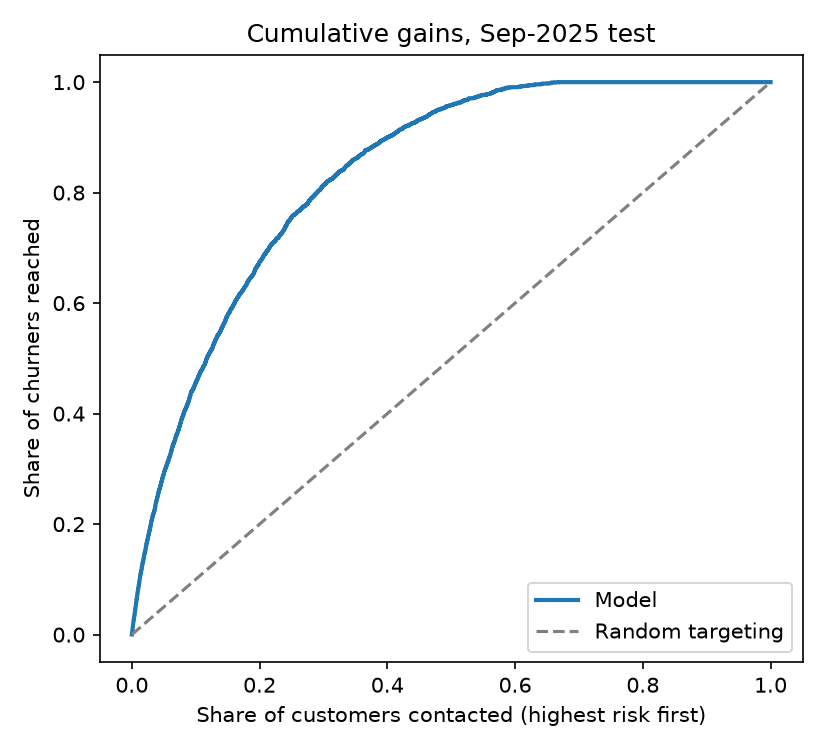

# SaaS Customer Churn & Cohort Retention Analysis: Project Report

**Author:** Mihir Bagadia  ·  **Stack:** SQL (DuckDB: CTEs, window functions), Python (pandas, scikit-learn, statsmodels, SciPy, Matplotlib), Tableau  ·  **Data:** 50,000 B2B SaaS customers, Jan 2023 - Dec 2025 (synthetic)

## 1. Executive summary

This project analyses why and when subscription customers leave a B2B SaaS company, and who is likely to leave next. SQL builds monthly acquisition cohorts, 12-month retention curves, ARPU, churn rates and an MRR bridge. A segment analysis finds where recurring revenue is most at risk, a logistic-regression model predicts 90-day churn, and an A/B testing framework sizes and analyses a retention campaign. Tableau-ready extracts feed three dashboards.

| Finding | Value |
|---|---|
| Customers analysed | 50,000 (550,995 customer-months, 20,362 cancellations) |
| 12-month logo retention | 56% overall; Basic 45%, Pro 62%, Enterprise 80% |
| Monthly logo churn | about 3.5-4%; spiked to 5.6% after the Jul-2024 Basic price increase |
| ARPU | $1,021 (Jan 2023) to $1,535 (Dec 2025) |
| Top 3 high-value segments at risk | Enterprise / 1000+ ($2.01M), Enterprise / 201-1000 ($1.30M), Pro / 201-1000 ($1.16M) of 12-month MRR at risk: **49% of the total** |
| Churn model (out-of-time test) | ROC-AUC **0.873**; riskiest 10% of customers contain **46% of churners** (4.6x lift) |
| A/B test design | 808 customers per arm detect a 15% churn reduction; 1,482 per arm available |

> **Important:** the data is synthetic, generated with known churn drivers, so findings show the method works rather than describe a real company. Section 9 lists what that means for each result.

## 2. Problem statement

A subscription company earns revenue only while customers keep paying. Losing customers (churn) cuts monthly recurring revenue (MRR), and acquiring replacements costs far more than keeping existing ones. Leadership needs to know:

1. How quickly does each signup cohort lose customers, and does it differ by plan, channel, company size or billing cycle?
2. What are ARPU and the monthly churn rate, and how did a 2024 price increase affect churn?
3. Which **high-value** segments put the most MRR at risk over the next 12 months?
4. Which active customers are most likely to cancel in the next 90 days, and what behaviors predict it?
5. If Customer Success runs a retention offer, how big must the test be and how do we judge it?

## 3. Dataset

### 3.1 Files and schema

| File | Rows | Grain | Columns |
|---|---|---|---|
| customers.csv | 50,000 | customer | customer_id, signup_date, plan (Basic, Pro, Enterprise), company_size (1-10, 11-50, 51-200, 201-1000, 1000+), region (North America, EMEA, APAC, LATAM), acquisition_channel (Organic, Paid Search, Referral, Partner, Outbound Sales), billing_cycle (monthly, annual), seats_at_signup |
| monthly_usage.csv | 550,995 | customer x paid month | customer_id, month, mrr, seats, active_users, logins, features_used (of 20), support_tickets, payment_failed (0/1), nps_score (quarterly survey, about 25% response) |
| cancellations.csv | 20,362 | churned customer | customer_id, cancel_date, cancel_reason |

### 3.2 How it is generated (`scripts/generate_data.py`)
- **Signups** grow about 2% a month from Jan 2023 to Dec 2025 (36 cohorts). Plan, channel and billing cycle depend on company size, so larger firms buy bigger plans through sales.
- **Pricing.** $10 / $25 / $50 per seat per month for Basic / Pro / Enterprise, 15% off for annual billing. Basic rises 20% to $12 in Jul 2024. MRR = seats x price.
- **Hidden account health.** Each customer has a health score that drifts monthly. Health drives every observable usage metric, so usage declines before a cancellation, as in real products.
- **Churn odds** each month depend on health, plan, company size, channel, region, the first three months of tenure (onboarding risk), a failed payment that month (involuntary churn) and the three months after the price increase. Annual customers can only leave at renewal, so a whole year of risk lands at month 12.
- **Seats** grow for healthy accounts and shrink for unhealthy ones, which creates expansion and contraction MRR.

A fixed random seed (42) means every number in this report reproduces exactly.

### 3.3 Real-data alternatives
Any subscription export with these three tables works unchanged. Public options: the IBM Telco Customer Churn dataset on Kaggle (one snapshot: suits the model but not cohorts) and the KKBox churn challenge on Kaggle (music subscriptions with transactions and logs: suits both). Neither is B2B SaaS.

## 4. Workflow

`python run_all.py` runs six steps in about 20 seconds on a laptop:

1. **Generate data:** `scripts/generate_data.py` → `data/raw/`.
2. **SQL in DuckDB:** `src/run_sql.py` loads the CSVs into `outputs/saas.duckdb` and runs `sql/01`-`05`, exporting each result table to `outputs/tables/`.
3. **Charts:** `src/cohort_charts.py` → `outputs/figures/`.
4. **Churn model:** `src/churn_model.py` trains, tests and scores customers.
5. **A/B test:** `src/ab_test.py` sizes the experiment, assigns arms, checks balance and analyses a simulated readout.
6. **Tableau extracts:** `src/export_tableau.py` → `outputs/tableau/`.

DuckDB was chosen because it runs in-process with no server, and its SQL is close to Postgres, Snowflake and BigQuery. Moving to BigQuery means changing date functions only: `DATE_DIFF('month', a, b)` becomes `DATE_DIFF(b, a, MONTH)` and `d + INTERVAL 1 MONTH` becomes `DATE_ADD(d, INTERVAL 1 MONTH)`.

## 5. Methodology: cohorts, KPIs and revenue at risk (SQL)

### 5.1 Definitions
- **Cohort:** the calendar month of signup; month 0 is the signup month.
- **Churn:** a customer churns in month M if they paid in M-1 and not in M.
- **Logo retention at month k:** customers still paying ÷ customers in the cohort at month 0.
- **Revenue retention at month k:** cohort MRR at month k ÷ cohort MRR at month 0 (includes expansion).
- **ARPU:** MRR ÷ active customers. **Logo churn rate:** churned in M ÷ active in M-1. **Gross MRR churn:** churned MRR ÷ starting MRR.

### 5.2 `01_customer_months.sql`: base table
Joins usage to customer attributes and adds, per customer ordered by month: `LAG(month)`, `LEAD(month)`, `LAG(mrr)` and `ROW_NUMBER()`. `LEAD(month) IS NULL` before the last data month marks the last paid month, which is how churn is detected without relying on the cancellations file.

### 5.3 `02_cohort_retention.sql`: cohort triangle and curves
```sql
WITH cohort_activity AS (
    SELECT cohort_month, months_since_signup,
           COUNT(DISTINCT customer_id) AS active_customers, SUM(mrr) AS mrr
    FROM customer_months GROUP BY 1, 2
)
SELECT *,
       active_customers / FIRST_VALUE(active_customers) OVER c AS logo_retention,
       mrr / FIRST_VALUE(mrr) OVER c                           AS revenue_retention
FROM cohort_activity
WINDOW c AS (PARTITION BY cohort_month ORDER BY months_since_signup);
```
Segment curves (by plan, channel, size, billing cycle) average only cohorts old enough to be observed at each age. Without this, young cohorts that have not reached month 12 would drag the curve down.

### 5.4 `03_monthly_kpis.sql`: churn rate, ARPU and the MRR bridge
For each month: active customers, MRR, ARPU, new and churned customers, logo churn rate and its 3-month moving average (`AVG() OVER (ROWS BETWEEN 2 PRECEDING AND CURRENT ROW)`), and the MRR bridge: new + expansion − contraction − churned. **Validation:** a running `SUM() OVER (ORDER BY month)` of net new MRR equals total MRR in every month (difference $0.00), which proves the churn and movement logic accounts for every dollar.

### 5.5 `04_segment_revenue_at_risk.sql`: where MRR is at risk
Fifteen segments (3 plans x 5 company sizes). For each: current customers and MRR, ARPU, and the average monthly logo and MRR churn over the last 6 months. MRR at risk over 12 months assumes the recent churn rate continues:

`MRR at risk (12 months) = current MRR × (1 − (1 − monthly MRR churn)^12)`

A segment is **high-value** when its ARPU is at or above the company ARPU. `RANK() OVER (ORDER BY mrr_at_risk_12m DESC)` ranks all segments and, separately, the high-value ones; `NTILE(3)` labels churn terciles.

### 5.6 `05_churn_features.sql`: model features
At eight quarterly snapshot months (Mar 2024 to Dec 2025), take every customer paying that month, summarise the three months ending there, and label `churned_next_90d = 1` if they are not paying three months later (null for Dec 2025, where the future is unknown). `ARG_MIN(x, month)` picks the start-of-window value for trend features; `ARG_MAX(nps_score, month)` picks the latest survey answer.

## 6. Churn prediction model

### 6.1 Features (21 inputs)

| Feature | Definition | Why it matters |
|---|---|---|
| plan, company_size, region, acquisition_channel, billing_cycle | one-hot encoded attributes | structural differences in churn |
| tenure_months | months since signup | early months are riskiest |
| log_mrr, log_seats | log of MRR and seats | account size and plan level |
| can_cancel_in_window | 1 if monthly billing or an annual renewal falls in the next 3 months | annual customers cannot leave mid-term |
| months_in_window | paid months in the 3-month window | marks brand-new accounts |
| seat_utilization_3m, seat_utilization_change | active users ÷ seats, and its change | unused seats signal low value |
| logins_per_user_3m, logins_per_user_change | logins per active user, and its change | depth of engagement |
| features_used_3m, features_used_change | features used (of 20), and its change | breadth of adoption |
| support_tickets_3m | tickets in the window | friction |
| payment_failures_3m | failed payments in the window | involuntary churn |
| mrr_change_pct_3m | MRR change over the window | contraction before churn |
| last_nps, has_nps | latest survey score; missing flag | stated satisfaction |

### 6.2 Training and testing
Splits are **by time, never random**, so the test imitates real use (train on the past, predict the future):

| Split | Snapshots | Rows | Churn rate |
|---|---|---|---|
| Train | Mar, Jun, Sep, Dec 2024; Mar 2025 | 85,793 | 10-13% |
| Validation (threshold choice) | Jun 2025 | 24,461 | 10.4% |
| Test (reported once) | Sep 2025 | 27,050 | 10.1% |
| Scoring (no label) | Dec 2025 | 29,638 | n/a |

Pipeline: one-hot encoding for categories; median imputation and standardization for numbers; `LogisticRegression` (scikit-learn, L2, C = 1). Logistic regression was chosen for readable coefficients (odds ratios) and well-behaved probabilities, which the revenue-at-risk math needs. The alert threshold (0.25) maximizes F1 on the validation quarter.

### 6.3 Why accuracy is the wrong headline
Only about 10% of customers churn in a 90-day window, so predicting "nobody churns" is already 89.9% accurate. The model's 91.0% accuracy at a 0.5 threshold is barely better. The metrics that matter are ROC-AUC (ranking quality), precision and recall at the chosen threshold, and **lift**: how much churn the riskiest customers contain compared with average.

## 7. Results

### 7.1 Cohort retention


| Segment | Month 1 | Month 3 | Month 6 | Month 12 |
|---|---|---|---|---|
| All customers | 94.3% | 84.6% | 77.5% | 56.3% |
| Basic | 91.7% | 78.0% | 68.5% | 45.3% |
| Pro | 95.9% | 88.7% | 82.9% | 61.8% |
| Enterprise | 99.0% | 97.0% | 95.1% | 80.1% |
| Referral | 96.3% | 90.1% | 84.4% | 68.2% |
| Paid Search | 90.7% | 76.5% | 67.5% | 42.7% |
| Company size 1-10 | 92.3% | 79.4% | 70.3% | 46.3% |
| Company size 1000+ | 98.4% | 95.9% | 93.5% | 80.7% |
| Annual billing | 100% | 100% | 100% | 67.1% |
| Monthly billing | 91.7% | 77.6% | 67.2% | 51.4% |

- **Month 12 cliff.** Annual contracts cannot leave mid-term, so their year of churn appears at renewal: annual retention drops from 100% at month 11 to 67% at month 12. Renewal outreach should start around month 9.
- **Channel quality.** Referral customers retain 68% at a year versus 43% for Paid Search, a 25-point gap that should feed into acquisition budgets (lifetime value by channel).
- **Early churn.** The steepest monthly losses are in months 1-3, which points to onboarding.


Each row of the heatmap is one cohort's decay; each column compares cohorts at the same age, which shows whether newer cohorts retain better or worse than older ones.

### 7.2 Churn rate, ARPU and the price increase


Monthly logo churn ran 3.5-4% and rose to **5.6% in Aug 2024 and 5.3% in Sep 2024**, after the Jul 2024 Basic price increase, before returning to about 3.6% by Dec 2025. ARPU rose from $1,021 to $1,535, driven by a growing share of larger customers and by the price increase itself. Gross MRR churn sits near 2% a month, well below logo churn, because the customers who leave are mostly small. Monthly net MRR retention is about 98%. By Dec 2025: 29,638 active customers and $45.5M MRR.

### 7.3 Revenue at risk by segment


| Rank | Segment | Customers | Current MRR | ARPU | Monthly MRR churn | 12-month MRR at risk | Share |
|---|---|---|---|---|---|---|---|
| 1 | Enterprise / 1000+ | 1,276 | $14.81M | $11,608 | 1.21% | $2.01M | 22.0% |
| 2 | Enterprise / 201-1000 | 1,674 | $9.30M | $5,557 | 1.24% | $1.30M | 14.2% |
| 3 | Pro / 201-1000 | 1,590 | $4.67M | $2,934 | 2.36% | $1.16M | 12.7% |
| 4 | Pro / 51-200 (not high-value) | 2,761 | $3.24M | $1,175 | 3.09% | $1.02M | 11.1% |
| 5 | Pro / 1000+ | 669 | $4.11M | $6,144 | 2.03% | $0.90M | 9.8% |

The top 3 high-value segments hold **49% of all MRR at risk** while being 15% of customers. Their churn rates are low; their risk comes from size. That is the key insight: the segments with the highest churn rates (Basic / 1-10 at 5.3% a month) put little money at risk, so retention spend belongs with large accounts even though they churn least.

### 7.4 Churn model

| Metric (Sep 2025 test, 27,050 customers) | Value |
|---|---|
| ROC-AUC | **0.873** (validation 0.879) |
| PR-AUC | 0.475 (a random model scores about 0.10) |
| Brier score | 0.069 |
| Accuracy at 0.5 | 91.0% vs 89.9% for "predict nobody churns" |
| At threshold 0.25: precision / recall / F1 | 40.8% / 53.8% / 0.464 |
| Confusion matrix at 0.25 | TP 1,469 · FP 2,128 · FN 1,260 · TN 22,193 |
| Top-decile lift | **4.55x**; the riskiest 10% contain 45.6% of churners |



**Drivers (largest standardized coefficients).** Being able to cancel in the window dominates: annual customers not near renewal had zero churn in the test quarter versus 14.8% for the rest. Larger companies, higher MRR per seat, more features used, higher seat utilization and Referral acquisition lower risk; Paid Search acquisition and more support tickets raise it. Because MRR, seats and plan are correlated, read individual coefficients with care; the model's job is ranking, not causal explanation.


**Scoring Dec 2025 (29,638 active customers):**

| Risk tier | Customers | Avg churn probability | MRR | Expected 90-day MRR at risk |
|---|---|---|---|---|
| High (top decile) | 2,964 | 46.9% | $1.78M | $819K |
| Medium (deciles 8-9) | 5,928 | 19.2% | $5.21M | $974K |
| Low | 20,746 | 2.8% | $38.50M | $788K |

`outputs/tableau/customer_churn_scores.csv` is the account list Customer Success works from.

### 7.5 A/B testing framework

Campaign: High-tier customers get proactive Customer Success outreach and 15% off for 3 months; control gets business as usual.

1. **Design.** Baseline 90-day churn for the riskiest decile is 45.9% (observed in the test quarter). Detecting a 15% relative reduction (to 39.0%) with α = 0.05 and 80% power needs **808 customers per arm** (Cohen's h, `statsmodels` `NormalIndPower`). With 1,482 per arm available, the smallest detectable reduction is 11.1%. Primary metric: 90-day churn. Secondary: retained MRR. Guardrails: discount cost, tickets, downgrades. Fixed 90-day horizon, no early stopping.
2. **Assignment.** SHA-256 hash of `"retention-offer-2026q1:" + customer_id`; buckets 0-49 are treatment. Deterministic, auditable, re-randomized by changing the salt.
3. **Balance.** Standardized mean differences are all under 0.06 in absolute value for churn probability, MRR, tenure, share on Basic and share on monthly billing (rule of thumb: under 0.1).
4. **Analysis.** Sample-ratio-mismatch chi-square test, two-proportion z-test, 95% CI for the difference, relative change, retained MRR, campaign cost and ROI.

**Simulated readout** (an assumed 20% true effect, used only to test the code; not a finding): treatment churn 35.7% vs control 49.2%, difference −13.5 points (95% CI −17.0 to −10.0), p < 0.001, sample-ratio check passed (p = 0.63).

### 7.6 Tableau dashboards
`tableau/DASHBOARD_SPEC.md` specifies three dashboards built on the CSVs in `outputs/tableau/`: **Retention overview** (KPI tiles, churn trend with the price-change annotation, MRR bridge), **Cohort decay** (heatmap with a logo / revenue toggle, curves switchable by dimension) and **Revenue at risk** (segment bars with the top 3 highlighted, ARPU vs churn quadrant, filterable at-risk account list). The workbook is built by hand in Tableau Public and linked from the README.

## 8. Technologies

| Area | Tools |
|---|---|
| SQL | DuckDB 1.x/2.x: CTEs, LAG, LEAD, ROW_NUMBER, FIRST_VALUE, RANK, NTILE, running SUM/AVG, ARG_MIN/ARG_MAX |
| Python | pandas, NumPy |
| Modeling | scikit-learn (Pipeline, ColumnTransformer, OneHotEncoder, StandardScaler, LogisticRegression, metrics) |
| Statistics | statsmodels (power analysis, z-test), SciPy (chi-square) |
| Visualization | Matplotlib (report charts), Tableau Public (dashboards) |
| Reproducibility | fixed seeds, one-command runner, requirements.txt |

## 9. Limitations

1. **Synthetic data.** The churn drivers were designed into the generator, so the analysis rediscovers known effects. Model performance on real data is usually lower, and real usage data is messier (tracking gaps, plan migrations, reactivations).
2. **Revenue-at-risk projection** assumes the last six months' churn rate holds for a year and ignores expansion, new sales and seasonality.
3. **Churn definition** is non-payment; it does not separate voluntary from involuntary churn in the SQL (the cancellations file does), and it ignores downgrades.
4. **The model** is linear and uses correlated features (MRR, seats, plan), so coefficients are not causal. Gradient boosting may rank better; logistic regression was kept for interpretability.
5. **Snapshot overlap.** A customer appears in several training snapshots, so training rows are not independent; the out-of-time test guards against the leakage that matters.
6. **The A/B readout is simulated.** The framework is real; the effect size is an assumption. ROI uses a simple 12-month value of retained MRR.
7. **Tableau workbook** is not in the repo; it must be built from the spec.

## 10. How to replicate and publish

```bash
git clone https://github.com/<you>/saas-churn-cohort-analysis.git
cd saas-churn-cohort-analysis
python -m venv .venv && source .venv/bin/activate     # Windows: .venv\Scripts\activate
pip install -r requirements.txt
python run_all.py                                     # ~20 seconds; everything lands in outputs/
python run_all.py --skip-data                         # rerun analysis without regenerating data
```
Explore the SQL interactively: `duckdb outputs/saas.duckdb`, then `SELECT * FROM monthly_kpis;`.

For GitHub: commit code, SQL, docs, `outputs/figures/` and the small CSVs in `outputs/tables/` and `outputs/tableau/`. Skip `data/raw/` and `outputs/saas.duckdb` (regenerated in seconds; already in `.gitignore`). Build the Tableau dashboards, publish them to Tableau Public, and put the link and screenshots at the top of the README.

## 11. Resume alignment and interview notes

The resume bullets on 50,000+ customers, SQL window functions, cohorts, 12-month retention curves, ARPU, churn rates, 3 high-value segments, logistic regression, an A/B framework and Tableau all match this build. Two changes keep it accurate:

- **Replace "83 correct churn predictions per 100".** It does not match this build, and accuracy is misleading at a 10% churn rate. Suggested wording: *"Built an out-of-time logistic-regression churn model (ROC-AUC 0.87); targeting the top risk decile reached 46% of churners (4.6x lift)."*
- **Label the data** as synthetic, as the Bank Loan project already does, and build the Tableau dashboards before interviews.

Questions to prepare:

1. Why split by time instead of randomly? A random split leaks future behavior into training.
2. Why is accuracy misleading here, and what did you use instead?
3. Why do low-churn Enterprise segments top the revenue-at-risk list?
4. How did you size the A/B test, and what would invalidate the result (sample-ratio mismatch, peeking)?
5. What does the month-12 drop in the curves mean for the business?

## Appendix: file guide

| File | What it does |
|---|---|
| `scripts/generate_data.py` | builds customers, monthly usage and cancellations |
| `sql/01_customer_months.sql` | base customer-month table with LAG / LEAD / ROW_NUMBER |
| `sql/02_cohort_retention.sql` | cohort triangle and segment retention curves |
| `sql/03_monthly_kpis.sql` | churn rate, ARPU, MRR bridge, NRR |
| `sql/04_segment_revenue_at_risk.sql` | segment ARPU, churn and 12-month MRR at risk, ranks |
| `sql/05_churn_features.sql` | quarterly feature snapshots and 90-day labels |
| `src/run_sql.py` | loads CSVs into DuckDB, runs the SQL, exports tables |
| `src/cohort_charts.py` | retention, churn, ARPU and segment charts |
| `src/churn_model.py` | trains, evaluates and scores the churn model |
| `src/ab_test.py` | power analysis, hash assignment, balance check, readout |
| `src/export_tableau.py` | Tableau data sources |
| `tableau/DASHBOARD_SPEC.md` | dashboard build instructions |
| `run_all.py` | runs everything in order |
