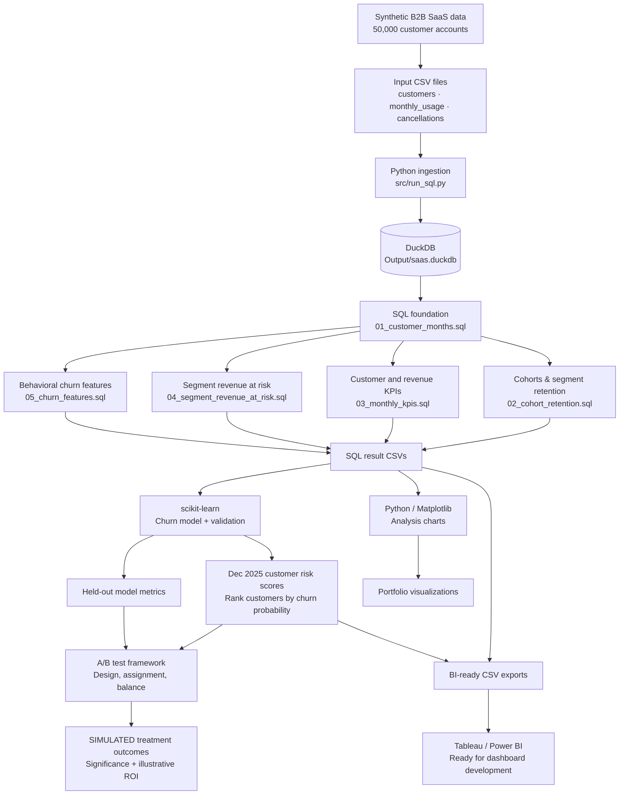
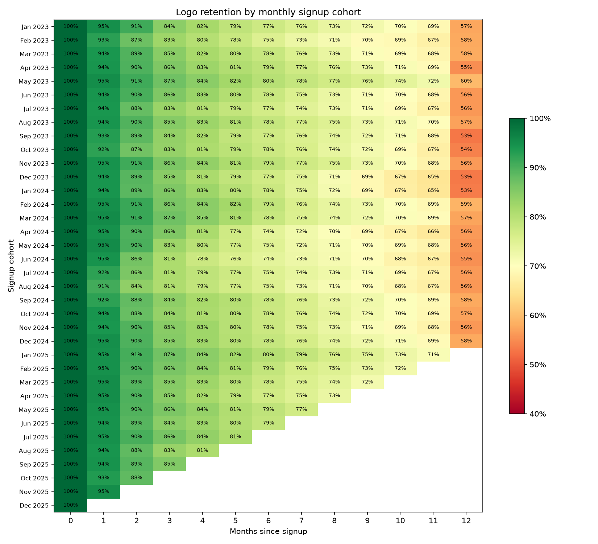
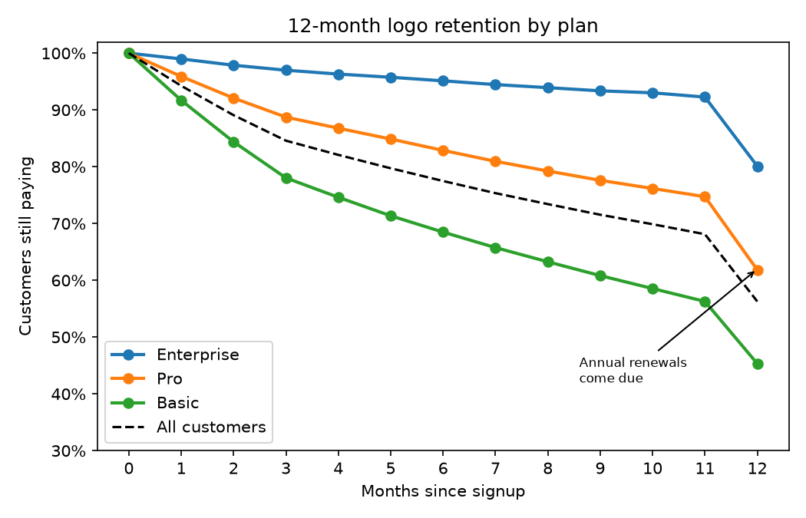
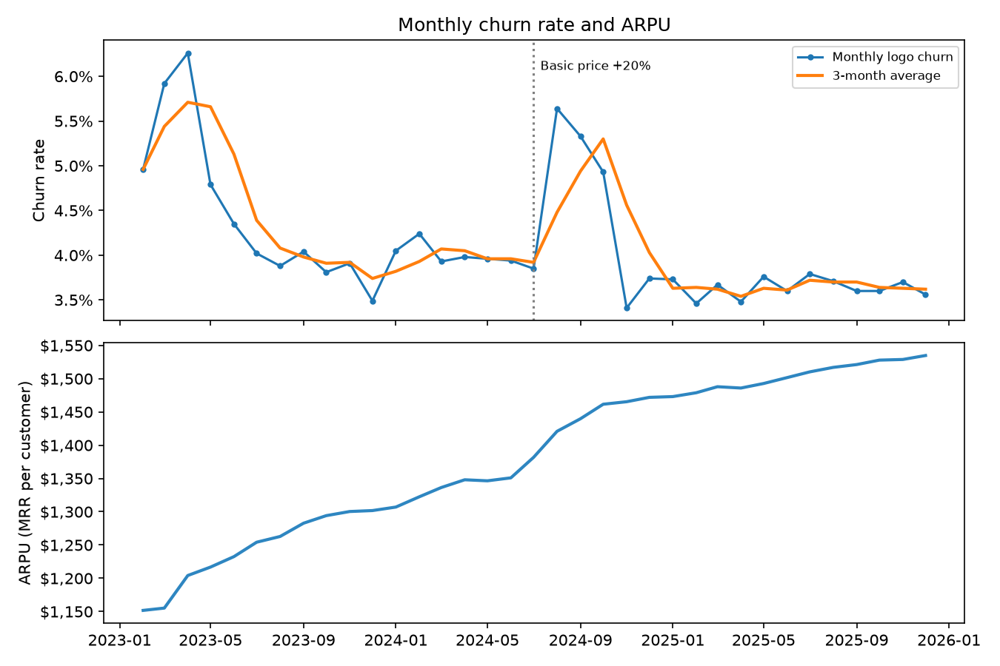
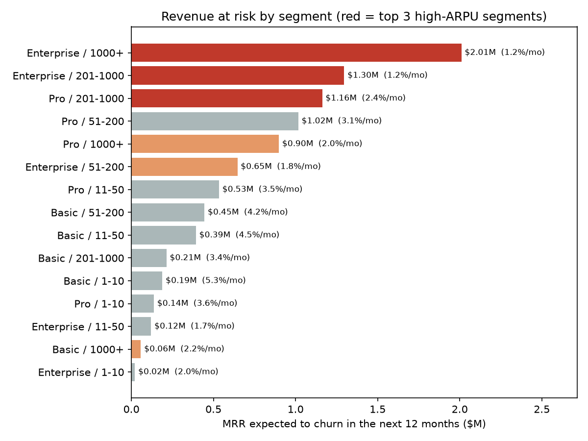
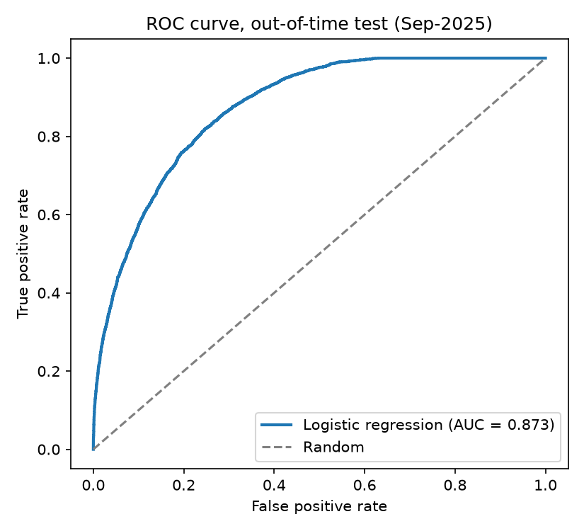

# SaaS Customer Churn & Retention Analytics

### From subscription data to actionable retention decisions
**Author:** Mihir Bagadia 

**SQL (DuckDB) · Python · Cohort Analysis · Business Intelligence · Predictive Modeling · A/B Testing**

A complete, reproducible analytics project exploring **when SaaS customers leave, which segments put recurring revenue at risk, who is likely to churn next, and how a retention campaign could be evaluated**.

> **Project transparency:** This portfolio project uses **synthetic B2B SaaS data**. Model results are evaluated on simulated customer histories. The A/B test is a **simulation with an assumed treatment effect**, not an experiment conducted with real customers. Tableau-ready CSV exports are available; a published Tableau workbook has not been verified.

---

## 📌 Project at a glance

| | Result |
|---|---:|
| Customers analyzed | **50,000** |
| Monthly subscription usage records | **550,995** |
| Recorded cancellations | **20,362** |
| Monthly signup cohorts | **36** (Jan 2023–Dec 2025) |
| Subscription plan × company-size segments | **15** |
| **ROC-AUC**, held-out Sep 2025 churn model | **0.873** |
| Actual churners captured by highest-risk **10%** | **45.6%** (**4.56× lift**) |
| Active accounts scored in Dec 2025 | **29,638** |
| High-risk customers selected for A/B test design | **2,964** |

### The business problem

For a subscription business, growing signups does not guarantee healthy growth. Customers may stop using the product, downgrade, or cancel—reducing predictable recurring revenue.

A data analyst needs to answer four connected questions:

1. **When and where are customers leaving?** Examine lifecycle retention, subscription plans, company sizes, and acquisition channels.
2. **How much revenue is exposed?** Monitor churn and recurring revenue, then rank account segments by financial exposure.
3. **Who should Customer Success prioritize?** Predict 90-day churn risk and create an outreach list.
4. **Would an intervention work?** Design a randomized experiment to evaluate retention offers *before* recommending a rollout.

**What this project delivers:** A SQL-powered analytics pipeline, business KPIs, visual analysis, a churn-risk scoring model, and a fully specified A/B test framework.

---

## 🔄 End-to-end workflow



**How the pieces connect:** The SQL customer-month table is the shared foundation. Retention, revenue, and modeling queries reuse it. Python evaluates the model; its risk scores define the eligible customers for the A/B test. The output files can then support a BI dashboard and Customer Success recommendations.

**Pipeline command:** `python run_all.py --skip-data` uses the CSV files currently stored in `Data/`.

---

## 📊 1. Customer retention — *When do customers leave?*

**Business need.** Overall churn can hide *when* customers disengage. A company must distinguish early onboarding problems from annual renewal risk.

**Method used.** We created **36 signup-month cohorts**, from January 2023 through December 2025. Each cohort groups customers who joined during the same calendar month; we then follow the group for up to **12 months after signup**.

**Why signup-month cohorts?** They compare customers at the same point in their subscription lifecycle. Monthly granularity also matches the underlying usage records, while offering more detail than quarterly or annual cohorts.

**SQL implementation:** [`Sql/02_cohort_retention.sql`](Sql/02_cohort_retention.sql), built on [`Sql/01_customer_months.sql`](Sql/01_customer_months.sql).

```sql
-- Monthly cohort and lifecycle age, from the customer-month base
CAST(DATE_TRUNC('month', c.signup_date) AS DATE) AS cohort_month

-- Then, for each cohort and month since signup:
COUNT(DISTINCT customer_id) AS active_customers
```

**Measures**

- **Logo retention:** Customers paying at lifecycle month *k* ÷ customers paying at month 0.
- **Revenue retention:** Cohort MRR at month *k* ÷ the cohort's starting MRR; expansion can affect this ratio.
- **Segment retention:** Separate lifecycle curves by plan, company size, acquisition channel, and billing cycle. **These are one-dimensional segment curves, not fully crossed signup-month × plan × size cohorts.**

### Illustrative findings from this synthetic dataset

| Segment | Retention at month 12 |
|---|---:|
| **All customers** | **56.3%** |
| Basic plan | 45.3% |
| Pro plan | 61.8% |
| Enterprise plan | 80.1% |

**Business interpretation:** Basic accounts warrant closer investigation of early engagement, while Enterprise accounts show comparatively stronger retention. Annual subscribers have a pronounced renewal-period decline because the generator only permits annual-contract churn at renewal.

**Potential action:** Review first-quarter onboarding, track plan-level product adoption, and start annual-renewal outreach ahead of renewal dates. These are **recommendations to test**, not proven causes or realized improvements.





---

## 💰 2. Subscription performance — *Are we retaining customers and revenue?*

**Business need.** Customer counts alone do not reveal whether the business is losing high-value accounts or expanding revenue from existing customers.

**Method used.** SQL calculates a monthly operating scorecard in [`Sql/03_monthly_kpis.sql`](Sql/03_monthly_kpis.sql):

| KPI | Calculation | Business purpose |
|---|---|---|
| **Logo churn rate** | Customers lost in month ÷ customers at start of month | Monitor subscriber loss |
| **MRR** | Sum of recurring revenue from paying customers | Track current subscription revenue |
| **ARPU** | MRR ÷ active paying customers | Understand account value |
| **MRR bridge** | New MRR + expansion − contraction − churned MRR | Explain changes in recurring revenue |
| **Net MRR retention** | (Starting MRR + expansion − contraction − churned MRR) ÷ starting MRR | Assess revenue retention excluding new customers |

**Why SQL window functions?** `LAG()` compares a customer's current recurring revenue with the preceding paid record. `LEAD()` helps identify missing future paid months, while rolling averages smooth month-to-month churn fluctuations.

**Illustrative finding:** Churn increases around the simulated July 2024 Basic-plan price change. This is an association in a generator that explicitly includes a price-change effect—not causal evidence from a real-world pricing experiment.

**Potential action:** Track churn and MRR together when evaluating pricing changes, and investigate whether high churn is concentrated among lower-value customer segments.



---

## 🎯 3. Revenue-at-risk segmentation — *Where should retention effort go?*

**Business need.** The segment with the *highest churn rate* is not necessarily the segment with the *greatest financial exposure*.

**Method used.** [`Sql/04_segment_revenue_at_risk.sql`](Sql/04_segment_revenue_at_risk.sql) divides accounts into **15 segments** (3 plans × 5 company-size bands), calculates recent logo and revenue churn, and projects the amount of the **current MRR base** potentially lost over a 12-month horizon:

```text
12-month MRR at risk
  = Current segment MRR × [1 − (1 − monthly MRR churn rate)^12]
```

This is a **scenario estimate**, assuming the recent churn rate remains constant. It is **not** 12 months of accumulated revenue losses and does not include new sales or future expansion.

**Why combine plan and company size?** Both characteristics help explain account value and different renewal behaviors; segmentation makes it possible to prioritize revenue exposure rather than churn percentage alone.

**Key insight:** In the earlier segment report, the largest high-value exposures were Enterprise / 1000+, Enterprise / 201–1000, and Pro / 201–1000. Their previously reported exposures were approximately **$2.01M**, **$1.30M**, and **$1.16M**, respectively. Refresh exact current rankings from `Output/tables/segment_revenue_at_risk.csv` after each run.

**Potential action:** Give high-MRR accounts appropriate human review and prioritize retention spending using **risk × account value**, rather than churn rate alone.



---

## 🤖 4. Churn prediction — *Which accounts are likely to leave next?*

**Business need.** Reporting identifies historical problems. Customer Success also needs a forward-looking list of accounts to prioritize.

**Method used.** [`Sql/05_churn_features.sql`](Sql/05_churn_features.sql) builds **quarterly customer snapshots**, using account characteristics and recent three-month behavior. [`src/churn_model.py`](src/churn_model.py) then trains a **logistic regression** classifier.

### What the model considers

| Feature category | Examples | Why relevant |
|---|---|---|
| Account attributes | Plan, company size, acquisition channel, billing type | Capture customer mix |
| Subscription value | MRR, licensed seats, tenure | Capture commercial context |
| Product engagement | Seat utilization, login activity, feature adoption | Surface disengagement |
| Support and payment | Tickets, failed payments, NPS | Surface friction |
| Renewal timing | Eligible to cancel within the prediction window | Reflect contract constraints |

**Why logistic regression?** It offers a transparent, regularized baseline with interpretable coefficients and probability estimates. More complex classifiers might perform better, but that would require a fair benchmark—not an assumption.

**Why time-based evaluation?** Train on earlier snapshots, select a threshold on a later validation snapshot, then evaluate on a still-later test snapshot. This more closely resembles predicting future customer behavior than randomly mixing rows from different dates.

### Out-of-time test performance — September 2025

| Metric | Result | What it tells us |
|---|---:|---|
| **ROC-AUC** | **0.873** | Good ability to rank churn risk in this synthetic dataset |
| **PR-AUC** | **0.475** | Precision–recall quality when churn is less common |
| Precision at threshold 0.25 | **40.9%** | Of flagged accounts, the proportion that churned |
| Recall at threshold 0.25 | **53.9%** | Of churners, the proportion flagged |
| **Top-decile capture** | **45.6%** | The highest-risk 10% contain almost half of actual test churners |
| **Top-decile lift** | **4.56×** | Churner concentration relative to random targeting |

**Why not emphasize accuracy?** With only about 10% churn in the test set, predicting “no churn” for everyone would already achieve approximately **89.9% accuracy**. Risk ranking, recall, precision, and lift are more actionable.




**Business output:** The model scores **29,638 active customers** in December 2025 and identifies **2,964 high-risk accounts**. The high-risk group has an estimated **$819,163** in current-MRR-weighted 90-day exposure, based on summed `churn_probability × MRR`.

**Potential action:** Use the ranked list to direct outreach toward customers with high predicted risk, while recognizing that prediction does not establish which intervention will help them.

---

## 🧪 5. A/B testing — *Would a retention offer actually help?*

**Business need.** A churn model can identify *who may leave*; it cannot prove that a discount or outreach campaign *prevents* churn. A randomized A/B test would help evaluate that causal question.

**Proposed experiment**

- **Population:** 2,964 customers in the highest-risk decile.
- **Treatment:** Proactive Customer Success outreach plus **15% off for three months**.
- **Control:** Normal experience without the offer.
- **Primary metric:** 90-day logo churn.
- **Additional measures:** Retained MRR and net revenue retention; discount cost, support tickets and downgrades as planned guardrails.
- **Assignment:** Reproducible approximately 50/50 customer-level allocation using SHA-256 hashing.

### Why design sample size before running the experiment?

To reduce the risk of an underpowered test and avoid interpreting random fluctuations as meaningful business outcomes.

| Planning assumption | Value |
|---|---:|
| Baseline control churn | **46.01%** |
| Minimum detectable *relative* reduction | **15%** |
| Target churn at that effect | **39.11%** |
| Statistical significance threshold (α) | **0.05** |
| Statistical power | **80%** |
| **Required minimum sample** | **805 per group** |
| Approximate customers available | **1,482 per group** |
| Planned observation | Fixed 90-day outcome window |

### Simulation readout — not a real experiment

The code assumes a **20% reduction in treatment customers' churn probabilities** and generates hypothetical outcomes to exercise the statistical analysis.

| Outcome | Simulated result |
|---|---:|
| Treatment customers | 1,495 |
| Control customers | 1,469 |
| Treatment churn | **36.79%** |
| Control churn | **47.11%** |
| Absolute churn-rate difference | **−10.32 percentage points** |
| Relative churn-rate difference | **−21.9%** |
| 95% confidence interval | **−13.85 to −6.78 percentage points** |
| Two-proportion test | **p < 0.00001** |
| Sample-ratio check | Passed; **p = 0.633** |
| **Simplified, simulated ROI** | **252%** |

**Why these tests?** A two-proportion Z-test compares churn rates; a confidence interval gives a plausible range for the difference; a sample-ratio check looks for unexpected allocation imbalance; and an ROI scenario translates the assumed retention effect into an illustrative business case.

**Crucial interpretation:** These numbers **do not demonstrate that the offer works in reality**. The improvement was assumed by the simulator. A real campaign, observed outcomes, and guardrail monitoring would be needed before making a deployment recommendation.

---

## 🛠️ Why these technologies?

| Tool / method | Where used | Why it fits this project |
|---|---|---|
| **DuckDB + SQL** | Ingestion, joins, window functions, aggregations, features | Embedded analytical database; no separate server required |
| **Python + Pandas/NumPy** | Data handling and model preparation | Flexible DataFrame processing and numerical analysis |
| **Monthly signup cohorts** | Retention analysis | Compare customers at the same subscription age |
| **Logistic regression** | Churn prediction | Transparent baseline, probability scoring, explainable parameters |
| **scikit-learn Pipeline** | Model preprocessing and evaluation | Reusable encoding, imputation, scaling and modeling |
| **statsmodels + SciPy** | A/B test design and analysis | Power calculations, proportion tests and balance checks |
| **Matplotlib** | Charts | Reproducible analysis figures |
| **Tableau-ready CSV exports** | BI handoff | Easy input for future interactive dashboards |

**Why DuckDB rather than MySQL, PostgreSQL, or Pandas alone?** All could complete this analysis. DuckDB was selected because the pipeline is a **local, batch analytical workload**, not an application that needs a database server, user transactions, or many simultaneous writers.

---

## 🗂️ Project structure

```text
SaaS-Customer-Churn-Cohort-Retention-Analysis/
├── Data/
│   ├── customers.csv
│   ├── monthly_usage.csv
│   └── cancellations.csv
├── Sql/
│   ├── 01_customer_months.sql
│   ├── 02_cohort_retention.sql
│   ├── 03_monthly_kpis.sql
│   ├── 04_segment_revenue_at_risk.sql
│   └── 05_churn_features.sql
├── scripts/
│   └── generate_data.py
├── src/
│   ├── config.py
│   ├── run_sql.py
│   ├── cohort_charts.py
│   ├── churn_model.py
│   ├── ab_test.py
│   └── export_tableau.py
├── Output/
│   ├── tables/
│   ├── figures/
│   ├── tableau/
│   └── saas.duckdb
├── requirements.txt
└── run_all.py
```

The database and generated outputs are created locally; some may not be versioned in Git.

### Main deliverables

| Output | Contents |
|---|---|
| `Output/tables/cohort_retention.csv` | 36 monthly cohorts, by months since signup |
| `Output/tables/retention_curves.csv` | Retention by plan, size, channel and billing cycle |
| `Output/tables/monthly_kpis.csv` | MRR, ARPU, churn, revenue movement |
| `Output/tables/segment_revenue_at_risk.csv` | 15 plan/size segment exposures |
| `Output/tables/churn_features.csv` | Customer snapshot features and future-churn labels |
| `Output/tables/model_metrics.json` | Validation and held-out test performance |
| `Output/tableau/customer_churn_scores.csv` | Ranked customer-level churn probabilities |
| `Output/tables/ab_test_design.json` | Experiment assumptions and sample-size analysis |
| `Output/tables/ab_test_simulated_readout.json` | Explicitly simulated A/B outcomes |
| `Output/figures/` | All generated Matplotlib visualizations |
| `Output/tableau/` | Six BI-ready CSV datasets |

---

## ▶️ How to run

**Prerequisites:** Python and packages in `requirements.txt`.

```bash
git clone https://github.com/mihir0786/SaaS-Customer-Churn-Cohort-Retention-Analysis.git
cd SaaS-Customer-Churn-Cohort-Retention-Analysis
python -m venv .venv
```

Activate the environment:

```powershell
# Windows PowerShell
.\.venv\Scripts\Activate.ps1
```

```bash
# macOS / Linux
source .venv/bin/activate
```

Install dependencies, then reuse the existing source CSVs:

```bash
pip install -r requirements.txt
python run_all.py --skip-data
```

**Important path note:** The current `src/config.py` reads inputs from `Data/`, but `scripts/generate_data.py` still defaults to `data/raw/`. To **regenerate and analyze the same dataset**, explicitly run:

```bash
python scripts/generate_data.py --out Data --customers 50000 --seed 42
python run_all.py --skip-data
```

`src/run_sql.py` **deletes and rebuilds** `Output/saas.duckdb` each run. Back up manual database changes before rerunning.

**Verify the latest numbers** from `Output/tables/model_metrics.json`, `Output/tables/ab_test_design.json`, `Output/tables/ab_test_simulated_readout.json`, and the output CSVs. If data or code changes, reported metrics may change.

---

## ⚠️ Interpretation and limitations

- **Synthetic data:** The generator embeds churn drivers and renewal behavior. Observed patterns and model performance may not generalize to real customers.
- **Cohort granularity:** Cohorts are monthly signup groups; segment curves are separate comparisons, not fully crossed cohort-by-plan-by-size tables.
- **Churn definition:** Monthly SQL uses the absence of a following paid record. Model labels check payment status three months after a snapshot; this is not a detailed event-time survival model.
- **Revenue scenarios:** Segment MRR exposure assumes recent churn persists. Customer-level expected MRR exposure is a probability-weighted measure, not a realized loss.
- **Model interpretation:** Correlated predictors and coefficients must not be interpreted causally. Annual-renewal eligibility is particularly influential because of simulation rules.
- **A/B simulation:** The treatment effect is explicitly assumed. ROI is annualized using a simplified value and cost calculation. Guardrails are specified but not fully evaluated against observed campaign data.
- **BI status:** The project generates Matplotlib visualizations and Tableau-ready files; it does not automatically publish an interactive Tableau workbook.

---

## 📈 Business recommendations and next steps

| Finding or capability | Suggested next business step | What still needs validation |
|---|---|---|
| Early lifecycle and plan-level retention differences | Investigate onboarding and product adoption | Whether interventions improve real retention |
| Annual renewal-period risk | Pilot proactive renewal outreach | Customer-level causal impact |
| High-MRR segments have material exposure | Prioritize account review by revenue and risk | Financial return on retention effort |
| Risk model concentrates churners in top decile | Create a risk-based outreach queue | Prospective performance on real accounts |
| A/B framework identifies an adequately sized test | Run a controlled retention experiment | Real churn outcomes, costs and guardrails |

### Future improvements

- Develop and publish a Tableau Public dashboard using `Output/tableau/` extracts.
- Add cohort intersections such as **signup month × plan × company size**.
- Compare logistic regression with tree-based models and evaluate calibration.
- Test the pipeline with real, permissioned subscription histories.
- Run an actual randomized retention trial and report observed effects.

---

## Project takeaway

**This project connects descriptive analytics, financial analysis, predictive modeling, and experimentation into one decision-oriented workflow.** It demonstrates how a Data Analyst can transform raw subscription records into clear KPIs, identify business risks, prioritize customers, and design a defensible way to evaluate proposed solutions—while distinguishing simulated examples from validated real-world results.
