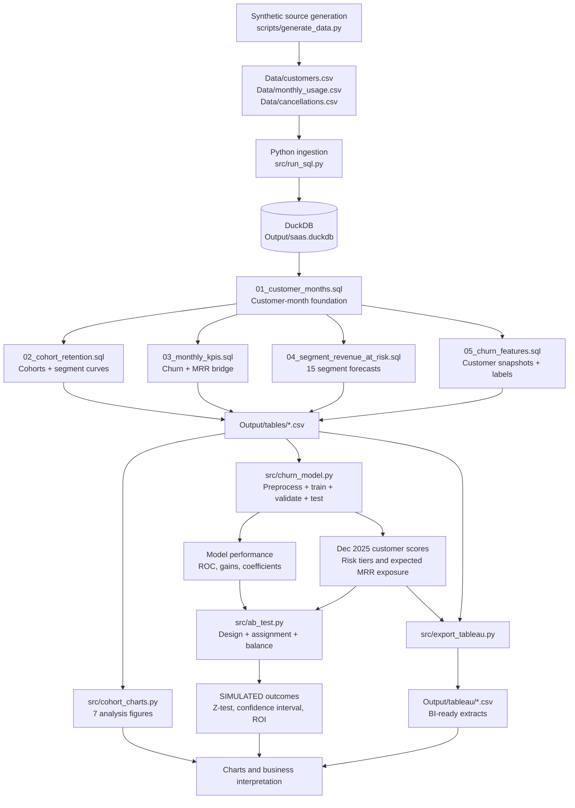
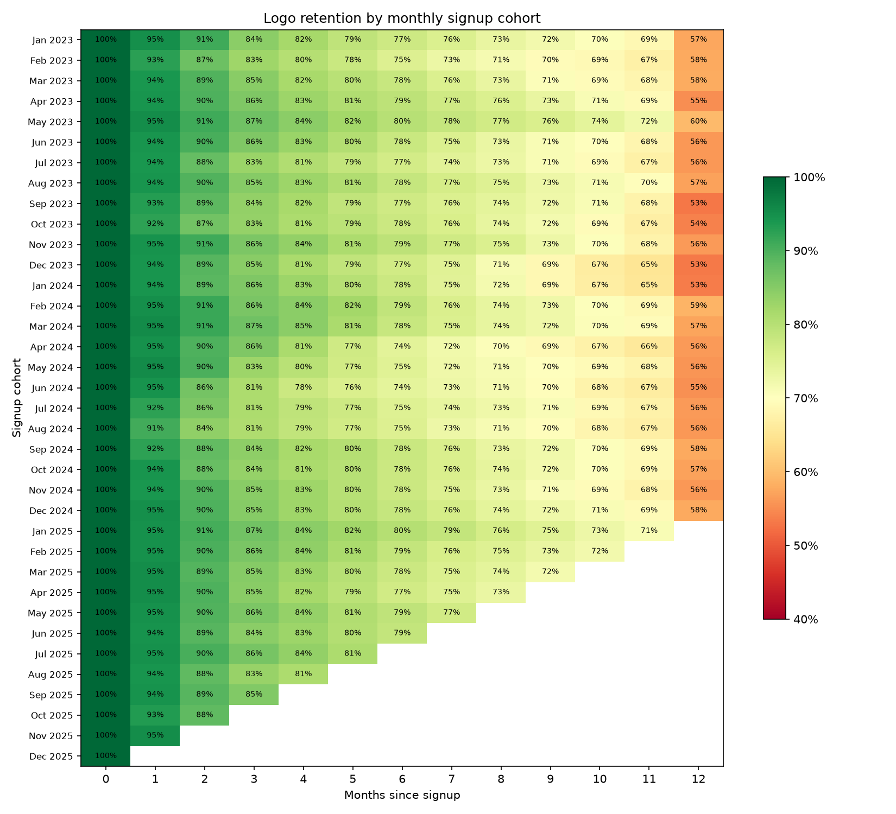
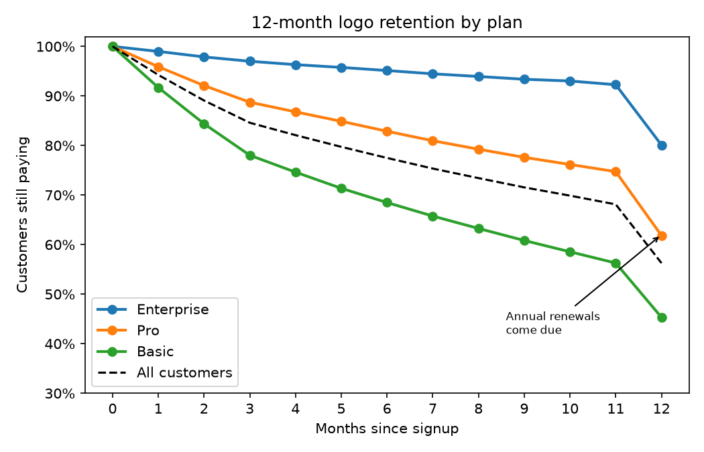
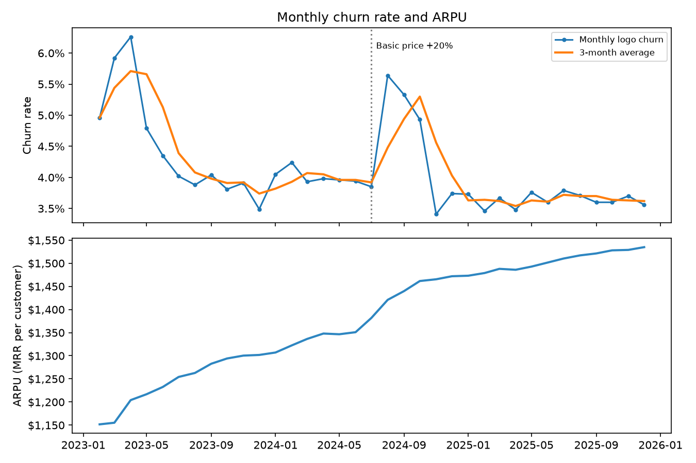
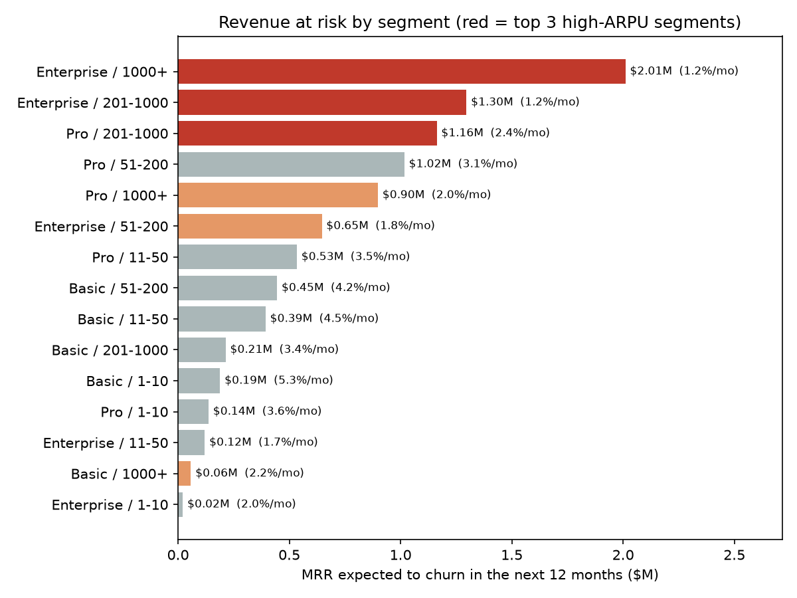
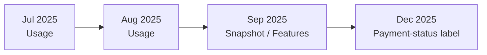
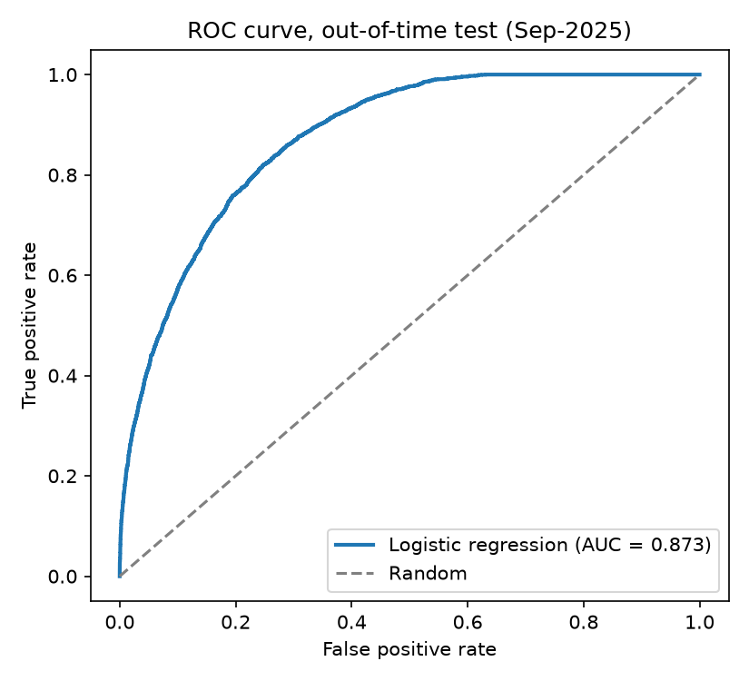
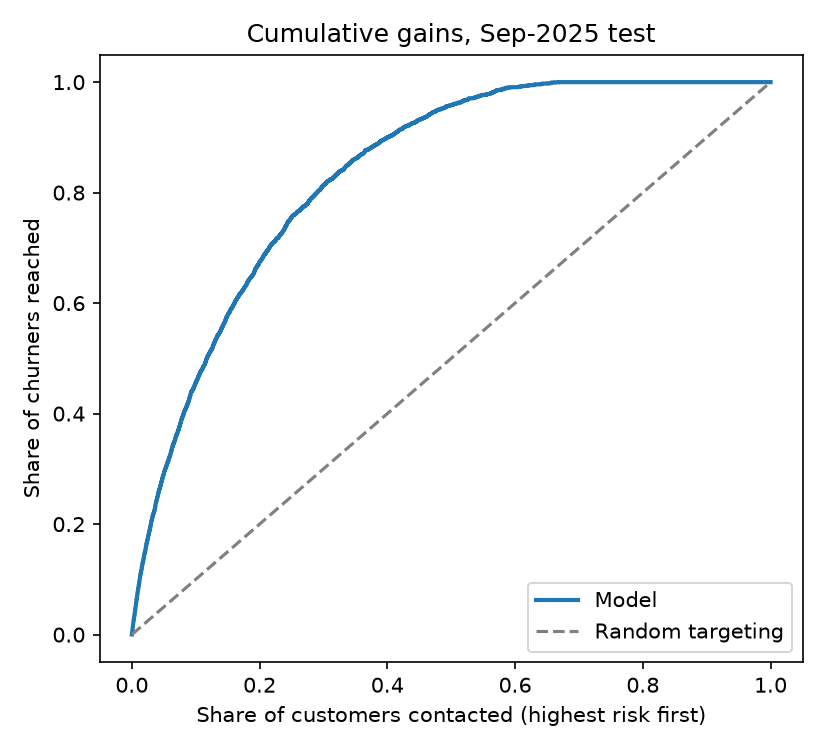
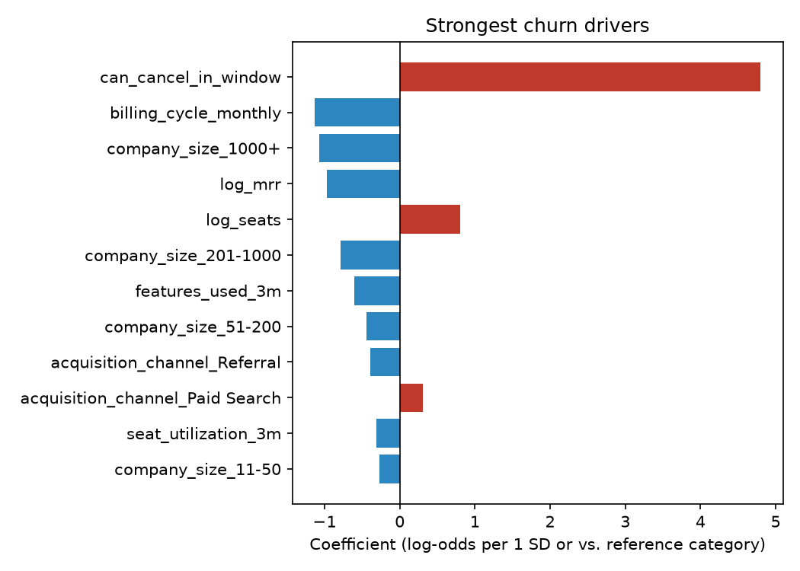
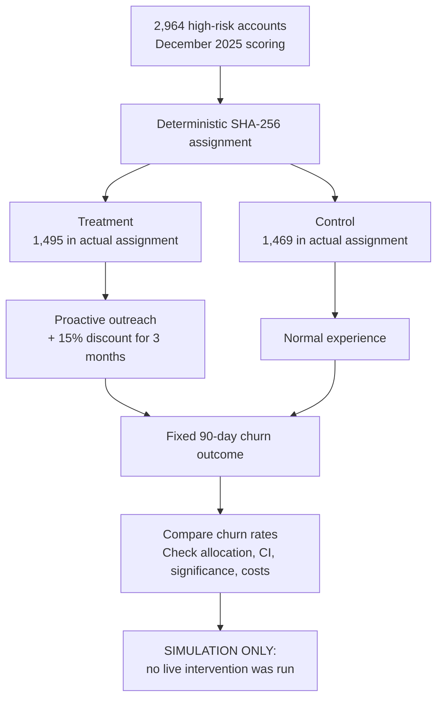

# SaaS Customer Churn, Cohort Retention & Revenue Risk Analysis

**Technical and Business Analysis Report**  
**Focus:** Subscription analytics · Customer retention · Revenue exposure · Predictive modeling · Experiment design  
**Technology:** SQL (DuckDB), Python, Pandas, NumPy, scikit-learn, statsmodels, SciPy, Matplotlib; Tableau-ready CSV exports  
**Analysis period:** January 2023–December 2025  
**Data:** Synthetic B2B SaaS subscription history

> **Evidence standard:** This report documents the methods in the repository and the output from a successfully executed analysis using its supplied CSVs. Results are illustrative because the customer histories are **synthetic**. A/B treatment outcomes are **simulated using an assumed treatment effect**; no live campaign was conducted. Recommendations are proposed actions, not demonstrated business improvements. 

## Executive summary

This project develops an end-to-end analytics workflow for a hypothetical B2B software-as-a-service (SaaS) business. The core business question is: **How can a subscription company measure customer loss, understand the revenue exposed to that loss, identify accounts at greatest risk, and rigorously evaluate potential retention interventions?**

Rather than treating churn prediction as an isolated machine-learning task, the project connects five analytical decisions: **(1)** when customers leave, **(2)** which customer segments behave differently, **(3)** where recurring revenue is vulnerable, **(4)** which active customers merit attention, and **(5)** how to test a retention offer.

### Verified scale and key outputs

| Area | Metric | Result / status |
|---|---|---:|
| Input data | Customer accounts | **50,000** |
| Input data | Paid customer-month usage records | **550,995** |
| Input data | Cancellation records | **20,362** |
| Time | Acquisition cohorts | **36** monthly cohorts, Jan 2023–Dec 2025 |
| Retention | Overall month-12 logo retention | **56.3%** in the reported segment curve |
| Segmentation | Plan × company-size combinations | **15** |
| Predictive model | Held-out Sep 2025 ROC-AUC | **0.873** |
| Predictive model | Held-out precision / recall at 0.25 cutoff | **40.9% / 53.9%** (reported run) |
| Predictive model | Highest-risk 10% capture of actual churners | **45.6%** (**4.56× lift**) |
| Risk scoring | Dec 2025 active customers scored | **29,638** |
| Risk scoring | Top-risk decile selected for experiment design | **2,964** |
| Experiment design | Minimum size to detect 15% relative churn reduction | **805 per arm** |
| Simulated A/B readout | Treatment vs control churn | **36.79% vs 47.11%** |
| Simulated A/B readout | Relative reduction / estimated ROI | **21.9% / 252%** — **simulation only** |

### Executive interpretation

**Retention differs by customer segment and lifecycle age.** In the reported synthetic results, Enterprise accounts retain substantially better than Basic accounts after 12 months; annual renewal timing creates a pronounced month-12 drop. This suggests separate onboarding and renewal-focused strategies, subject to testing.

**Churn frequency and financial exposure are not interchangeable.** The analysis estimates exposure for 15 plan/size segments. Large accounts can contribute more dollars at risk even with lower churn rates, making a simple “target the highest-churn group” approach incomplete.

**The model can prioritize investigation.** On the held-out test, the highest-risk 10% contains 45.6% of actual churners. That is useful as a *ranking* metric, but neither prediction nor classification proves that contacting an account will prevent it from leaving.

**The experiment framework bridges analytics to causal evaluation.** The project specifies treatment and control groups, a primary outcome, sample-size and power targets, deterministic allocation, balance checks and statistical testing. Its example readout is simulated, not evidence of a real discount campaign's effectiveness.

---

## Contents

1. [Business context and analytical objectives](#1-business-context-and-analytical-objectives)
2. [End-to-end architecture and workflow](#2-end-to-end-architecture-and-workflow)
3. [Data sources, structure and assumptions](#3-data-sources-structure-and-assumptions)
4. [Data preparation and DuckDB](#4-data-preparation-and-duckdb)
5. [Cohort and customer retention analysis](#5-cohort-and-customer-retention-analysis)
6. [Monthly business KPIs and revenue movements](#6-monthly-business-kpis-and-revenue-movements)
7. [Revenue-at-risk segmentation](#7-revenue-at-risk-segmentation)
8. [Churn feature engineering and modeling](#8-churn-feature-engineering-and-modeling)
9. [Model performance and chart interpretation](#9-model-performance-and-chart-interpretation)
10. [Customer prioritization and risk scoring](#10-customer-prioritization-and-risk-scoring)
11. [A/B testing: design, statistics and simulated readout](#11-ab-testing-design-statistics-and-simulated-readout)
12. [Decision framework: questions, answers and business actions](#12-decision-framework-questions-answers-and-business-actions)
13. [Quality assurance, reproducibility and limitations](#13-quality-assurance-reproducibility-and-limitations)
14. [Recommendations and extensions](#14-recommendations-and-extensions)
15. [Technical appendix and glossary](#15-technical-appendix-and-glossary)

---

## 1. Business context and analytical objectives

### 1.1 Why customer retention matters

A subscription business receives recurring payments while accounts remain active. New acquisitions can make customer counts grow even when existing customers are leaving; therefore, the analyst must look beyond total signups. The important distinctions are:

- **Customer (logo) churn:** How many paying accounts are lost?
- **Revenue churn:** How much existing recurring revenue is lost, including differences in account value?
- **Retention:** How many original accounts—or how much original revenue—remain after a given period?
- **Prediction:** Which current accounts have higher estimated future churn risk?
- **Causal impact:** Would a specific intervention actually change cancellation behavior?

**Simple example.** Start with 1,000 paying accounts. If 50 cancel and 100 sign up, the ending account count is 1,050, yet the churn rate relative to the starting base is **50 / 1,000 = 5%**. Growth alone would hide the loss.

### 1.2 Stakeholders and their decisions

| Stakeholder | Question | Analytical deliverable | Decision supported |
|---|---|---|---|
| Executive leadership | Is subscription revenue healthy? | Monthly churn, MRR, ARPU, revenue bridge | Set retention priorities |
| Product / onboarding | At what subscription age do customers leave? | Month-0 to month-12 cohort heatmap | Investigate onboarding and adoption |
| Sales / Growth | Which acquired customer types retain longer? | Retention by plan, company size and channel | Review acquisition quality and targeting |
| Finance | Where is the largest revenue exposure? | Segment revenue-at-risk estimates | Prioritize financial review |
| Customer Success | Which accounts should we investigate first? | Ranked churn scores, risk deciles | Design outreach queues |
| Product experimentation | Does an offer cause lower churn? | A/B test design, outcome metrics and guards | Decide whether to launch a real pilot |

### 1.3 Scope and success criteria

The project is successful as an **analytics demonstration** if it can: build reproducible analytical tables from source records; explain cohort and KPI calculations; evaluate a churn model on a later time period; produce actionable prioritization outputs; and distinguish statistical experiment **design** from observed causal results.

It does **not** establish that an actual SaaS company achieved the reported retention, financial savings, or model accuracy.

---

## 2. End-to-end architecture and workflow

### 2.1 Full data and decision workflow



**Reading this diagram:** Raw files become database tables; SQL builds a common analytical foundation; separate downstream queries answer retention, financial, and predictive questions; the model identifies a risk-prioritized target population; and the A/B module demonstrates how to evaluate a proposed intervention. BI-ready exports make these outputs accessible for future dashboards.

### 2.2 Why this order matters

1. **Ingest and validate** before analysis. No downstream metric is trustworthy if customer identifiers or dates are inconsistent.
2. **Create one customer-month foundation** instead of repeatedly rebuilding joins. This standardizes retention and financial definitions.
3. **Describe the past** with cohorts and KPIs before predicting future churn; otherwise we lack business context.
4. **Quantify financial stakes** before choosing high-priority targets. The highest-risk group is not automatically the highest-value group.
5. **Evaluate the model using later dates** before scoring current customers. This is more realistic than randomly mixing historical and future records.
6. **Design a randomized test** before claiming that an offer improves retention. Historical associations and model risk scores alone cannot establish treatment effectiveness.

### 2.3 Main scripts and responsibilities

| Script / SQL file | Input | Output | Responsibility |
|---|---|---|---|
| `scripts/generate_data.py` | Random seed and generator assumptions | Three source CSVs | Create synthetic subscription histories |
| `src/run_sql.py` | CSVs; SQL files | DuckDB file; analytical CSVs | Execute ingestion and SQL pipeline |
| `Sql/01_customer_months.sql` | Customer and usage tables | `customer_months` | Standardize customer-month history |
| `Sql/02_cohort_retention.sql` | `customer_months` and customers | `cohort_retention`, `retention_curves` | Lifecycle retention |
| `Sql/03_monthly_kpis.sql` | `customer_months` | `monthly_kpis` | Monthly finance and churn |
| `Sql/04_segment_revenue_at_risk.sql` | `customer_months` | `segment_revenue_at_risk` | Financial exposure |
| `Sql/05_churn_features.sql` | `customer_months` | `churn_features` | Historical features and churn targets |
| `src/cohort_charts.py` | SQL-exported CSVs | Retention/churn/segment PNGs | Visual analysis |
| `src/churn_model.py` | `churn_features.csv` | Metrics, model charts, account scores | Evaluation and prioritization |
| `src/ab_test.py` | Scores and model metrics | Design, allocations, balance, simulated readout | Experiment framework |
| `src/export_tableau.py` | SQL outputs and model scores | Six `Output/tableau/` CSVs | BI handoff |

---

## 3. Data sources, structure and assumptions

### 3.1 Scope and grain

**Grain** means “what a single row represents.” This matters because counting rows in a transaction or usage table is not the same as counting unique customers.

| File | Rows loaded | One row represents | Important fields |
|---|---:|---|---|
| `Data/customers.csv` | **50,000** | One customer account | `customer_id`, `signup_date`, `plan`, `company_size`, `region`, `acquisition_channel`, `billing_cycle`, `seats_at_signup` |
| `Data/monthly_usage.csv` | **550,995** | One paid customer-month | `customer_id`, `month`, `mrr`, `seats`, `active_users`, `logins`, `features_used`, `support_tickets`, `payment_failed`, `nps_score` |
| `Data/cancellations.csv` | **20,362** | One cancelled account | `customer_id`, `cancel_date`, `cancel_reason` |

**Source relationship:** `customer_id` joins customer attributes with monthly usage. The cancellation file is also ingested, but the main retention/KPI SQL infers lost paying months from the usage history rather than using cancellation reasons directly.

### 3.2 What the synthetic generator assumes

The generator includes multiple B2B SaaS-like mechanisms: three plans (Basic, Pro, Enterprise); five company-size bands; four regions; five acquisition channels; monthly or annual billing; customer engagement and account-health dynamics; price and seat-based revenue; payment failures; and a simulated **July 2024 Basic-plan price increase**.

Under the generator's rules, annual contracts can churn at renewal. This is why an annual-renewal effect is expected in the retention curves. Such a pattern should be described as a **modeled design feature**, not discovered causal evidence.

### 3.3 Relevant data preparation checks

Before interpreting results, an analyst should check:

| Question | Suggested validation | Why it matters |
|---|---|---|
| Is `customer_id` unique in `customers`? | `COUNT(*)` vs `COUNT(DISTINCT customer_id)` | Duplicate customer attributes multiply usage rows after a join |
| Is there at most one usage record per customer-month? | Group by `customer_id, month` and test count > 1 | Duplicate paid months inflate MRR and retention |
| Are all usage customers present in `customers`? | LEFT JOIN and check unmatched IDs | Inner joins could silently drop records |
| Are seats and MRR valid? | Check negative/zero values and nulls | Revenue/usage ratios could be invalid |
| Are all dates within the study window? | `MIN`, `MAX`, and invalid-date checks | Prevent accidental cohort misalignment |
| Are missing NPS scores handled? | Missingness count and imputation review | Satisfaction responses are sparse |
| Are there gaps in a customer's paid months? | Inspect `LAG(month)` / `LEAD(month)` differences | Impacts churn and retention definitions |

These are recommended checks; successful file loading alone does **not** prove they all pass.

---

## 4. Data preparation and DuckDB

### 4.1 Why DuckDB?

The application is a **local analytical (OLAP) workflow**: it joins records, aggregates many customer-months, applies window functions, and saves analytical results. DuckDB is an embedded SQL engine oriented toward columnar/vectorized analytical execution. It offers analytical SQL and direct Python integration **without requiring a database server**.

We did **not** choose it because PostgreSQL, SQLite, or Pandas could not complete the task. They could. DuckDB was a practical fit for the desired combination of SQL-heavy batch transformations, CSV input, local execution and reproducibility. No comparative performance benchmark was performed.

### 4.2 Ingestion code: `src/run_sql.py`

```python
for name in ("customers", "monthly_usage", "cancellations"):
    con.execute(f"""
        CREATE OR REPLACE TABLE {name} AS
        SELECT * FROM read_csv_auto(
            '{(RAW / f"{name}.csv").as_posix()}', header = true
        )
    """)
```

This loop reads each source file into a DuckDB table, inferring column types. The program then runs the numbered SQL scripts in order and exports most resulting tables to `Output/tables/`. The large intermediate `customer_months` table remains in DuckDB rather than being exported as a CSV.

### 4.3 SQL foundation: `Sql/01_customer_months.sql`

```sql
WITH base AS (
    SELECT u.customer_id, u.month, u.mrr,
           c.plan, c.company_size, c.billing_cycle,
           CAST(DATE_TRUNC('month', c.signup_date) AS DATE) AS cohort_month
    FROM monthly_usage AS u
    JOIN customers AS c USING (customer_id)
)
SELECT *,
       DATE_DIFF('month', cohort_month, month) AS months_since_signup,
       LAG(month) OVER w AS prev_month,
       LEAD(month) OVER w AS next_month,
       LAG(mrr) OVER w AS prev_mrr,
       ROW_NUMBER() OVER w AS paid_month_number
FROM base
WINDOW w AS (PARTITION BY customer_id ORDER BY month);
```

*The excerpt above omits several selected usage columns for readability; see the linked SQL file for the complete code.*

**Explanation in plain language:** The join attaches each customer's plan and other characteristics to each paid month. `DATE_TRUNC` assigns a signup cohort. `DATE_DIFF` measures subscription age in months. `LAG` fetches previous paid-month information, `LEAD` fetches the next recorded paid month, and `ROW_NUMBER` counts available paid records.

| Derived field | Business meaning | Common use |
|---|---|---|
| `cohort_month` | Calendar month the account signed up | Cohort retention |
| `months_since_signup` | Subscription lifecycle age | Compare cohorts fairly |
| `prev_month` | Prior recorded paying month | Revenue movement / gaps |
| `next_month` | Following recorded paying month | Churn inference |
| `prev_mrr` | Prior observed MRR | Expansion and contraction |
| `paid_month_number` | Ordinal number of observed paid months | History diagnostics |

**Important nuance:** `LEAD(month)` returns the *next recorded* month, which may skip over missing months. A null `next_month` means no later record exists; it is not automatically evidence of churn when the dataset ends.

---

## 5. Cohort and customer retention analysis

### 5.1 Business question

> **At what subscription age are customers lost, and do retention patterns vary across customer groups?**

### 5.2 Why monthly acquisition cohorts rather than only plan or company size?

A **cohort** is a group of accounts that share a starting event: here, the **calendar month of signup**. Comparing January and February signups at “month 3” holds subscription age constant; comparing all customers in a calendar month does not.

Monthly cohorts were chosen because source activity is monthly and the 36-month observation period is long enough to show meaningful differences in signup periods. Weekly cohorts would be unnecessarily granular for monthly usage; annual cohorts would hide shorter-term onboarding and pricing patterns.

**Distinction:** `cohort_retention` contains **36 individual signup-month cohorts**. `retention_curves` also shows **separate aggregated curves** for plan (Basic/Pro/Enterprise), acquisition channel, company size and billing cycle. It does **not** currently create every individual `signup month × plan × company size` combination.

### 5.3 Retention definitions and mathematics

Let a cohort have `N0` paying customers and starting MRR `R0`. At lifecycle month `k`, `Nk` are paying with MRR `Rk`.

```text
Logo retention at month k    = Nk / N0
Revenue retention at month k = Rk / R0
```

**Example.** If 100 accounts join, 80 still pay at month 6, and cohort MRR goes from $10,000 to $9,200:

- Month-6 logo retention = 80 / 100 = **80%**.
- Month-6 revenue retention = 9,200 / 10,000 = **92%**.

Revenue retention is higher because surviving accounts may be spending more. Conversely, revenue retention can fall faster if high-value accounts cancel.

### 5.4 How the SQL works

In `Sql/02_cohort_retention.sql`, `cohort_activity` groups records by `cohort_month` and `months_since_signup`. `FIRST_VALUE` supplies the cohort's month-0 denominator and `LAG` compares neighboring lifecycle months.

```sql
COUNT(DISTINCT customer_id) AS active_customers,
SUM(mrr) AS mrr

-- In the following CTE:
FIRST_VALUE(active_customers) OVER c AS cohort_size,
FIRST_VALUE(mrr) OVER c AS starting_mrr

-- Final measures:
ROUND(active_customers / cohort_size, 4) AS logo_retention,
ROUND(mrr / starting_mrr, 4) AS revenue_retention
```

The script limits the cohort table to lifecycle months **0–12**. The resulting `cohort_retention.csv` had **390 rows** in the executed run, fewer than 36 × 13 because late cohorts do not yet have 12 months of follow-up.

For aggregated segment curves, the query generates eligible account-age combinations only where that age could have been observed before the study ended. This avoids treating unobserved future months as churn.

### 5.5 Graph 1 — Monthly signup cohort heatmap



**How to read it:** Each row is a signup month; each column is months since signup. A cell gives the fraction still paying at that age. Month 0 is 100% by construction for the paying starting cohort.

**What to look for:**

1. **Horizontal patterns:** Which cohorts retain well or poorly as they age?
2. **Vertical patterns:** Are newer cohorts retaining better at the *same age* than older cohorts?
3. **A sharp drop:** Is loss concentrated around onboarding or contract renewal?
4. **Blank cells on newer cohorts:** Those customers haven't had enough time to reach that age. Blank does **not** mean 0% retention.

**Business importance:** This view helps prioritize *when* to intervene. It can separate early product-adoption issues from predictable renewal windows.

### 5.6 Graph 2 — Retention curves by plan



Reported month-12 retention from the project output:

| Segment | Month-12 logo retention |
|---|---:|
| Overall | **56.3%** |
| Basic | **45.3%** |
| Pro | **61.8%** |
| Enterprise | **80.1%** |

**Graph interpretation:** The Enterprise curve remains higher than the Pro and Basic curves. The annual renewal timing built into the generator produces a distinct drop around month 12. Comparing plan curves shows *which group* differs; the monthly heatmap shows *which acquisition periods* differ.

**Business questions answered:**

- **Which plan appears to retain best?** Enterprise, in the synthetic run.
- **Does this prove Enterprise pricing causes stronger retention?** No. Plan, customer size, billing terms and customer health are associated in the generator.
- **What action might follow?** Investigate Basic onboarding and adoption; separately plan earlier renewal outreach for annual contracts. Evaluate the actions with future data or experiments.

**Analytical caveat:** Segment curves pool customers from cohorts old enough to be observed at each lifecycle age. Their composition can therefore change with age; the chart is descriptive, not a causal comparison between fixed identical populations.

---

## 6. Monthly business KPIs and revenue movements

### 6.1 Business question

> **Are the company and its recurring revenue becoming healthier over time? What components explain changes in MRR?**

### 6.2 Key metrics

| Metric | Formula / approach | Interpretation |
|---|---|---|
| Active customers | Count of paying customer-month records | Paying accounts in the month |
| MRR | Sum of account `mrr` | Recurring revenue from the current paid base |
| ARPU | `MRR / active_customers` | Average recurring revenue per paying account |
| Logo churn | Customers lost in month M / customers paying in M−1 | How frequently accounts leave |
| Gross MRR churn | Lost MRR / MRR at month start | How much starting recurring revenue is lost |
| Net MRR retention | `(start MRR + expansion − contraction − churned) / start MRR` | Revenue movement excluding new sales |
| MRR bridge | `new + expansion − contraction − churned` | Explain month-over-month net revenue movement |

### 6.3 Revenue bridge example

Suppose MRR begins the month at **$100,000**. During the month the business gains **$8,000** in new subscriptions and **$5,000** in expansion, while existing accounts contract by **$2,000** and cancelled accounts remove **$4,000**.

```text
Ending MRR = 100,000 + 8,000 + 5,000 − 2,000 − 4,000
           = $107,000

Net MRR retention (excluding new sales)
           = (100,000 + 5,000 − 2,000 − 4,000) / 100,000
           = 99%
```

**Why this matters:** A higher ending MRR doesn't necessarily mean existing customers are retaining their spend; new subscriptions can offset churn. The bridge separates those effects.

### 6.4 SQL implementation

[`Sql/03_monthly_kpis.sql`](Sql/03_monthly_kpis.sql) uses multiple CTEs to calculate monthly activity, infer churn events from paid-month gaps, join the components, and calculate summary KPIs.

```sql
-- Three-month rolling average of monthly logo churn
ROUND(
    AVG(churned_customers / start_customers)
    OVER (ORDER BY month ROWS BETWEEN 2 PRECEDING AND CURRENT ROW),
    4
) AS logo_churn_rate_3m_avg
```

**Why a three-month moving average?** It reduces the distraction of single-month spikes, making the underlying trend easier to discuss. The raw monthly values remain important when identifying unusual changes.

### 6.5 Graph 3 — Monthly churn and ARPU



**How to read it:** One view follows the rate at which customer accounts leave; another follows average MRR per active account. The churn chart also contains a smoothed three-month trend and a reference to the simulated July 2024 Basic-plan price increase.

**Reported synthetic pattern:** Monthly churn generally sits around **3.5–4%** and increased shortly after the simulated Basic price increase. The project also shows ARPU rising over the study period.

**What this does and does not say:** The timing is consistent with the generator's explicit price-change effect. It is **not** an estimate of the causal effect that a real price increase would have on an actual company.

**Business importance:** Price, churn, and revenue should be monitored jointly. A price change can increase revenue per remaining customer while also increasing cancellations. Leadership needs both sides of the calculation.

### 6.6 Important data-quality note

The SQL infers churn when a customer paid in a prior month and is absent in the next month. This is operationally useful for the synthetic data; with real billing data, analysts should also distinguish delayed payments, pauses, reactivations, and voluntary vs involuntary cancellations.

---

## 7. Revenue-at-risk segmentation

### 7.1 Business question

> **Where could the company lose the most recurring revenue, not merely the most customers?**

A group with many low-spend cancellations may lose fewer dollars than a small number of large-account cancellations. Financial exposure helps distinguish these cases.

### 7.2 Segmentation logic

[`Sql/04_segment_revenue_at_risk.sql`](Sql/04_segment_revenue_at_risk.sql) groups accounts by **plan (3 levels) × company size (5 levels) = 15 segments**. For each, it calculates latest active customers, current MRR, ARPU, and recent churn rates across the prior six months.

It labels a segment **high-value** if its ARPU is at least the company-wide ARPU, then ranks projected risk using SQL `RANK()`.

### 7.3 What the 12-month MRR-at-risk formula means

```text
12-month projected MRR exposure
    = Current MRR × [1 − (1 − monthly MRR churn rate)^12]
```

**Example:** A segment currently generates **$1,000,000 MRR** and is assumed to lose **2%** of the remaining revenue base each month.

```text
Exposure = $1,000,000 × [1 − 0.98^12]
         ≈ $215,300 of today's MRR base
```

This is an estimate of **how much of the current monthly revenue run rate could disappear by month 12**, not the sum of all twelve months of lost revenue. It assumes a constant churn rate and ignores new sales, future expansion, and seasonality.

### 7.4 Graph 4 — Financial exposure by segment



The earlier run's segment table highlighted these high-value categories:

| Segment | Earlier reported 12-month projected MRR exposure |
|---|---:|
| Enterprise / 1000+ | ~$2.01M |
| Enterprise / 201–1000 | ~$1.30M |
| Pro / 201–1000 | ~$1.16M |

These values came from the earlier project report and should be refreshed from `Output/tables/segment_revenue_at_risk.csv` if rerunning the data. The reported top three were approximately **49%** of total projected segment exposure.

**What the graph tells us:** Large accounts may have lower *churn rates* but still represent high *dollar exposure* because each account generates far more MRR.

**Business interpretation:** Retention budgets should not be allocated solely by cancellation frequency. High-value segments may justify dedicated account managers, renewal reviews, or carefully controlled outreach—especially when predicted risk is also elevated.

### 7.5 Distinguish two risk measures in this project

| Measure | Where calculated | Interpretation |
|---|---|---|
| **Segment 12-month MRR exposure** | SQL segment query | Scenario projection using recent segment MRR churn |
| **Customer-level expected 90-day MRR exposure** | Python churn model | `predicted 90-day churn probability × current account MRR` |

These are different horizons and methods. **They should not be added together** as though they were independent financial losses.

---

## 8. Churn feature engineering and modeling

### 8.1 Business question

> **Which currently active accounts appear most likely to stop paying within the next three months?**

Descriptive reports tell us about historical patterns. Predictive analytics creates a forward-looking **ranking** to help Customer Success focus limited attention.

### 8.2 Feature table and label construction

[`Sql/05_churn_features.sql`](Sql/05_churn_features.sql) creates quarterly snapshot rows. Each row represents one account paying at a snapshot month, along with the preceding three months of observed behavior.

Snapshots are March, June, September and December of 2024 and 2025.

**Illustrative customer timeline**



The target is `churned_next_90d`: **1 if the account is absent from the paid-month table three calendar months after the snapshot; 0 if it remains; NULL when the future isn't yet observed.** This is a three-month-endpoint churn label, not a fully observed day-by-day time-to-cancellation measure.

**Feature families**

| Family | Examples | Business rationale |
|---|---|---|
| Customer attributes | Plan, size, geography, acquisition channel, billing cycle | Different commercial contexts |
| Tenure and renewal | Months since signup, `can_cancel_in_window` | Renewal eligibility and lifecycle stage |
| Value and contract size | `log_mrr`, `log_seats` | Account scale and spend |
| Product adoption | Seat utilization, logins per user, features used | Whether the customer is engaging |
| Change over time | Usage changes, MRR change | Declining usage may precede cancellation |
| Friction / satisfaction | Support tickets, payment failures, latest NPS | Problems that may signal risk |

**SQL methods:** `ARG_MIN` takes beginning-of-window values for change calculations; `ARG_MAX` obtains the latest eligible NPS observation; aggregation functions build three-month usage summaries. `NULLIF` prevents division by zero.

### 8.3 Why logistic regression?

[`src/churn_model.py`](src/churn_model.py) creates a scikit-learn `Pipeline` with:

- `OneHotEncoder(drop="first", handle_unknown="ignore")` for categorical variables.
- Median imputation and `StandardScaler` for numerical variables.
- `LogisticRegression(max_iter=2000, C=1.0)` for binary classification.

**Reasoning:** Logistic regression provides a regularized and interpretable baseline model that predicts probabilities. Coefficients can be inspected, but they are **associations conditional on the model's other inputs**, not proof that changing a particular feature would cause churn to rise or fall.

**Alternative methods:** Random Forest, gradient boosting (such as XGBoost), survival analysis, and more complex behavioral models could be evaluated. The repository does **not** establish that logistic regression is the best-performing algorithm among these alternatives; no benchmark comparison is documented.

### 8.4 Why train, validate, and test by time?

If we randomly mix older and newer account snapshots, the training set may contain customer behaviors from periods after records in the test set. A time-based split gives a more realistic assessment of future performance.

| Stage | Snapshot dates | Purpose |
|---|---|---|
| Training | Mar, Jun, Sep, Dec 2024; Mar 2025 | Fit the model |
| Validation | Jun 2025 | Choose the alert threshold by F1 |
| **Held-out test** | **Sep 2025** | Report generalization to a later cohort of snapshots |
| Operational scoring | Dec 2025 | Score active accounts without observed future labels |

The executed run reported **85,793 training rows** and **27,050 held-out test rows**. The chosen classification threshold was **0.25**, optimized on the validation snapshot. After evaluation, the code refits on all labeled snapshots before scoring December 2025 customers.

**Important caveat:** Multiple training snapshots can include the same customer; rows are not independent accounts. The time-based design is useful, but it does not remove every possible source of data leakage or correlation.

### 8.5 Logistic regression in simple mathematical terms

The model estimates a probability using a weighted score:

```text
z = intercept + coefficient1 × feature1 + ... + coefficientN × featureN
p(churn) = 1 / (1 + exp(−z))
```

The sigmoid function maps the score to a number between 0 and 1. A predicted `0.70` means a **modeled 70% chance of the defined churn outcome**, not a guarantee of cancellation. The classification threshold of `0.25` determines which predictions are flagged, but it does **not** change the underlying probability ranking.

---

## 9. Model performance and chart interpretation

### 9.1 Why accuracy is not the main metric

Only about **10.1%** of customers churn in the held-out snapshot. Predicting that *nobody* churns would already achieve approximately **89.9% accuracy**.

This is why the project emphasizes **ROC-AUC, PR-AUC, precision, recall and top-decile lift** rather than headline accuracy.

| Held-out test measure | Reported result | What it means |
|---|---:|---|
| Test rows | **27,050** | Evaluated customer snapshots |
| Churn prevalence | **10.1%** | Actual target frequency |
| **ROC-AUC** | **0.873** | Ability to rank churners above non-churners |
| **PR-AUC** | **0.475** | Precision–recall performance on the less frequent churn class |
| Accuracy at 0.50 | **91.0%** | Versus **89.9%** no-churn baseline |
| Precision at threshold 0.25 | **40.9%** | Fraction of flagged accounts that churned |
| Recall at threshold 0.25 | **53.9%** | Fraction of churners flagged |
| F1 at threshold 0.25 | **0.465** | Balances precision and recall |
| **Top-decile lift** | **4.56×** | Concentration of churners in highest-risk 10% |
| **Top-decile capture** | **45.6%** | Share of all churners located in highest-risk 10% |

### 9.2 Graph 5 — ROC curve



**Axes:** False-positive rate on the horizontal axis and true-positive rate (recall) on the vertical axis. The diagonal is random ranking.

**Meaning of ROC-AUC 0.873:** If a randomly selected churner and non-churner are compared, the model has about an **87.3% probability of ranking the churner higher**, subject to standard AUC interpretation. This is **not** “87.3% prediction accuracy.”

**Business use:** ROC-AUC helps compare overall ranking quality without selecting a particular outreach threshold. It does not itself say how many customer contacts will be useful or profitable.

### 9.3 Graph 6 — Cumulative gains and lift



**Axes:** Share of customers contacted, starting with the highest predicted risk, versus share of actual churners included in that targeted group.

**Result:** Contacting only the highest-risk **10%** would reach approximately **45.6%** of eventual churners in the held-out synthetic test. Random selection would reach about 10%, so the concentration lift is **45.6% / 10% = 4.56×**.

**Business use:** The metric is intuitive for capacity-limited teams. If Customer Success can review only 1 in 10 accounts, the model places substantially more churners in that queue than random prioritization. It does **not** mean contacting those accounts automatically saves them.

### 9.4 Graph 7 — Logistic regression coefficients



**What it shows:** Positive coefficients increase modeled **log-odds** of churn, while negative coefficients decrease them after accounting for other features. Numerical features are standardized; categorical features are compared to reference levels.

The leading coefficient in the executed run was **`can_cancel_in_window` (+4.7987)**. The simulator's annual renewal restrictions make eligibility to cancel a major discriminator for a three-month churn endpoint. Other visible features included billing type, company size, MRR, seats and feature usage.

**Critical interpretation:** A large coefficient is not the same as a large causal effect or an individual feature's independent importance. Correlated features—such as plan, company size, seats and MRR—make simplistic coefficient stories unreliable. The chart should support *diagnosis and hypothesis generation*, not causal claims.

### 9.5 Business model-evaluation questions

**Is the model good enough for deployment?** Not established. It ranks risk well in synthetic held-out data, but a production decision would require testing on real future customers, probability calibration, fairness/segment checks, stability monitoring, intervention economics and operational review.

**Should we contact everyone with p > 0.25?** Not automatically. The threshold maximized a statistical F1 score on validation data, not an expected financial return. Outreach should account for contact capacity, customer value, treatment costs and whether an account is actually responsive to intervention.

**Does a feature's coefficient tell us why a customer churned?** Not causally. It shows a model association, shaped by synthetic data rules and other included features.

---

## 10. Customer prioritization and risk scoring

### 10.1 December 2025 scoring

After model evaluation, the code refits the pipeline on labeled snapshots and scores accounts paying in December 2025. It then ranks churn probabilities into **10 equally sized risk deciles**.

- **High:** decile 10 (highest risk).
- **Medium:** deciles 8–9.
- **Low:** deciles 1–7.

The executed run scored **29,638** accounts; **2,964** were placed in the High tier.

### 10.2 Account-level expected MRR exposure

```python
score["expected_mrr_at_risk_90d"] = (
    score["churn_probability"] * score["mrr"]
).round(2)
```

**Illustrative example:** An account paying **$500 MRR** with a predicted three-month churn probability of **40%** contributes **$200** to this measure (`0.40 × $500`).

This is a **probability-weighted current MRR exposure**, not total 90-day contract revenue, not the sum of three lost monthly payments, and not guaranteed loss.

In the executed run, the **High tier** had approximately **$819,163** in aggregated expected 90-day MRR exposure. It is a useful prioritization indicator, not an accounting forecast.

### 10.3 Handoff to Customer Success

`Output/tableau/customer_churn_scores.csv` includes customer identifiers, segments, churn probabilities, deciles, tiers and MRR exposure. It can support an outreach list, subject to governance, business rules and experimentation.

**Important distinction:** A high churn probability predicts a *problem*; it does not predict which customer will respond positively to a discount. A future **uplift model** could help with the second question after real randomized intervention data is available.

---

## 11. A/B testing: design, statistics and simulated readout

### 11.1 Business question

> **Would proactive Customer Success outreach plus a temporary discount cause fewer high-risk customers to cancel than business-as-usual?**

The prediction model cannot answer that causal question on its own. Randomized experimentation is designed to estimate a treatment effect while reducing confounding.

### 11.2 Proposed experiment



**Primary measure:** 90-day logo churn. **Secondary measures:** retained MRR and net revenue retention. **Guardrails:** discount cost, support tickets per account, downgrades. The current simulation does not fully measure all guardrails; a real test would need instrumented outcomes.

### 11.3 Why randomization and a control group?

Without a control group, a company may incorrectly credit the offer for churn reductions that would have occurred anyway because of seasonality, differing customer types or changes in the economy. Randomization helps distribute known and unknown factors between groups *on average*.

The implementation creates reproducible customer-level assignment from a SHA-256 hash of a fixed salt plus `customer_id`. It is approximately 50/50 rather than forced to exactly equal-sized groups.

### 11.4 Statistical design and the MDE calculation

| Planning element | Value | Interpretation |
|---|---:|---|
| Eligible population | **2,964** | Highest-risk decile |
| Baseline churn | **46.01%** | Estimated control rate from held-out test metrics |
| Minimum detectable relative effect | **15%** | Target proportional reduction |
| Treatment churn at MDE | **39.11%** | `46.01% × (1 − 0.15)` |
| Alpha | **0.05** | False-positive threshold under the test assumptions |
| Power | **0.80** | Target chance to detect the specified real effect |
| Required per arm | **805** | Rounded sample-size calculation |
| Available per arm (planning) | **1,482** | Half the eligible population, rounded down |
| Detectable effect with available sample | **11.08% relative** | More sample provides better sensitivity |

**Why is 15% relative not 15 percentage points?** A 15% relative improvement on a 46.01% churn rate corresponds to **39.11%**, a **6.90 percentage-point** decrease. A 15-point reduction would instead produce 31.01%, a much larger effect.

The code uses `statsmodels` with a two-sample proportion power calculation (Cohen's *h* effect size), rather than choosing a sample size arbitrarily.

### 11.5 How the simulation is generated

The code explicitly sets:

```python
assumed_effect = 0.20  # simulated true relative reduction
p = target["churn_probability"].to_numpy()
p = np.where(target.arm == "treatment", p * (1 - assumed_effect), p)
sim = target.assign(churned=(rng.random(len(p)) < p).astype(int))
```

**In plain language:** The simulator takes each account's modeled cancellation probability, reduces it by **20%** for treatment accounts, and randomly generates hypothetical churn outcomes from those probabilities. The reported difference is therefore **not an independent discovery** that discounts work.

### 11.6 Simulated outcome results

| Metric | Value | Interpretation |
|---|---:|---|
| Treatment customers | **1,495** | Actual assigned count |
| Control customers | **1,469** | Actual assigned count |
| Treatment churn | **36.79%** | Simulated cancellations / treatment group |
| Control churn | **47.11%** | Simulated cancellations / control group |
| Absolute difference | **−10.32 percentage points** | 36.79% − 47.11% |
| Relative difference | **−21.9%** | Relative to control churn |
| 95% CI for absolute difference | **[−13.85, −6.78] percentage points** | Approximate normal confidence interval |
| Z statistic | **−5.692** | Two-proportion Z-test statistic |
| p-value | **< 0.00001** | JSON rounds it to `0.0` |
| Sample-ratio-mismatch p-value | **0.633** | No detected allocation-ratio problem |
| Statistical significance flag | **True** | On simulated outcomes under the defined test |

**Statistical meaning:** Given the simulated data and test assumptions, the treatment and control churn rates are unlikely to be equal. However, the simulator imposed a treatment advantage, so statistical significance is not evidence about a real offer.

### 11.7 What the 95% confidence interval means

The estimated treatment-minus-control churn difference is **−10.32 percentage points**. The approximate 95% interval spans **−13.85 to −6.78 points**, entirely below zero. Under repeated experiments and the method's assumptions, the interval procedure is designed to cover the true treatment effect 95% of the time. This is **not** a 95% probability that the effect is inside this one particular calculated interval.

### 11.8 Sample-ratio mismatch and covariate balance

A sample-ratio-mismatch (SRM) test checks whether the observed 1,495 / 1,469 split is implausibly different from the intended 50/50 allocation. **p = 0.633** does not indicate a problem. The code additionally checks standardized mean differences for churn score, MRR, tenure and selected account characteristics, with `|SMD| < 0.1` as a practical balance rule.

**Why both?** An approximately equal count does not guarantee balanced account characteristics. Conversely, passing these checks does not prove an absence of every bias or guarantee treatment compliance.

### 11.9 Simplified financial readout

| Per treated customer | Simulated result |
|---|---:|
| Incremental retained **monthly** MRR | **$61.59** |
| Estimated outreach + discount cost | **$209.79** |
| Annualized value of incremental retained monthly MRR | **$739.04** |
| Simplified ROI | **2.52**, or **252%** |

The code estimates retained monthly MRR as the observed difference in simulated retention rates multiplied by mean treatment-account MRR. Annual value multiplies this by 12, then compares it with modeled outreach and discount costs:

```text
ROI = (annualized retained-MRR value − campaign cost) / campaign cost
    ≈ ($739.04 − $209.79) / $209.79
    ≈ 2.52 = 252%
```

**Financial limitations:** This assumes the added monthly MRR persists for 12 months. It simplifies discount application, margin, opportunity cost, repeat churn, and customer lifetime value. A live business case should use observed revenue and actual campaign costs.

### 11.10 What would be required before a real rollout?

Finalize the offer and eligibility rules; verify customer consent and contact practices; pre-register the primary metric and observation window; monitor assignment, balance, discount use and support capacity; collect actual cancellation and revenue outcomes; and evaluate both statistical and financial effects without undisclosed early stopping.

---

## 12. Decision framework: questions, answers and business actions

| Business question | Evidence from the project | What it suggests | What remains unproven |
|---|---|---|---|
| **When do customers leave?** | Month-0 to month-12 cohorts; annual renewal cliff | Review onboarding and renewal milestones | That a particular intervention fixes the pattern |
| **Which plan retains best?** | Enterprise 80.1% vs Basic 45.3% month-12 retention | Segment the product adoption strategy | That plan type itself causes the difference |
| **Are customers and dollars being lost at the same rate?** | Separate logo and MRR churn measures | Track customer volume and financial exposure together | Future churn or revenue after the sample |
| **What happened around the price change?** | Churn rose after simulated July 2024 Basic price change | Inspect price sensitivity and engagement | A causal effect in a real business |
| **Which segments matter financially?** | Segment MRR exposure and high-value ranking | Evaluate account-management coverage for large accounts | Recoverable revenue from any campaign |
| **Can we prioritize likely churners?** | ROC-AUC 0.873; top 10% captures 45.6% of churners | Build a risk-based review queue | Performance on live future customers |
| **Does a retention discount work?** | Randomized design plus simulated treatment outcomes | Run a real controlled pilot | Real causal impact and ROI |
| **What dashboards could leadership use?** | Monthly KPI, cohort, segment and account CSV outputs | Build an interactive BI layer | A published Tableau dashboard (not verified) |

### Business impact: what can be responsibly claimed?

**Demonstrated analytical impact:** The pipeline produces consistent reporting measures and a ranked list of high-risk customers; in the synthetic test, that ranking concentrates almost half of churners in 10% of accounts.

**Potential organizational impact:** In a real business, a similar workflow could reduce manual reporting effort, improve prioritization of customer-success outreach, and provide a rigorous experiment design. This project **does not quantify actual operational time saved, revenue recovered, or cancellations prevented**.

### Recommended decision sequence

1. **Measure:** Monitor monthly logo churn, MRR, ARPU and cohort retention.
2. **Diagnose:** Break results down by subscription age, plan, channel and company size.
3. **Prioritize:** Combine customer-level risk with MRR and operational contact capacity.
4. **Experiment:** Randomize a clearly defined intervention and monitor actual 90-day outcomes.
5. **Scale only after evaluation:** Compare measurable retention benefit with full costs and guardrails.

---

## 13. Quality assurance, reproducibility and limitations

### 13.1 Reproduce the analysis

```bash
git clone https://github.com/mihir0786/SaaS-Customer-Churn-Cohort-Retention-Analysis.git
cd SaaS-Customer-Churn-Cohort-Retention-Analysis
python -m venv .venv
```

Activate the environment:

```powershell
# Windows PowerShell
.\.venv\Scripts\Activate.ps1
```

```bash
# macOS / Linux
source .venv/bin/activate
```

Then:

```bash
pip install -r requirements.txt
python run_all.py --skip-data
```

The `--skip-data` option analyzes the existing CSVs in `Data/`, which is the workflow successfully used for the reported run.

**Known generator-path mismatch:** The current `src/config.py` reads `Data/`, but `scripts/generate_data.py` defaults to `data/raw/`. To intentionally regenerate the data used by SQL, run:

```bash
python scripts/generate_data.py --out Data --customers 50000 --seed 42
python run_all.py --skip-data
```

**Destructive database behavior:** `src/run_sql.py` unlinks the prior `Output/saas.duckdb` before rebuilding. Any manual edits to that database will be lost unless backed up.

**Version-specific results:** If inputs, dependencies or code change, numerical outputs may differ. The best authoritative local checks are `Output/tables/model_metrics.json`, `Output/tables/ab_test_design.json`, `Output/tables/ab_test_simulated_readout.json`, and the SQL-generated CSVs.

### 13.2 Validation and reconciliation checklist

- [ ] Verify source record counts and uniqueness at their intended grains.
- [ ] Investigate unmatched IDs and duplicate customer-months before joining.
- [ ] Check cohort month 0 denominators and month-12 eligibility.
- [ ] Reconcile revenue movement components against actual MRR changes; investigate non-zero differences rather than assume a pass.
- [ ] Confirm score snapshots use only information available at scoring time.
- [ ] Verify results on later dates and ideally on real-world data when available.
- [ ] Confirm experiment allocation and covariate balance; register outcomes in advance.
- [ ] Recalculate charts and report tables after any change to source data.

### 13.3 Limitations that matter

1. **Synthetic-data bias:** The generator specifies relationships between engagement, contract timing, pricing, company characteristics and churn. Modeling them is an educational demonstration, not external validation.
2. **Cohort censoring:** Newer signup cohorts have fewer observed ages. Treat missing future months as unknown, not churn.
3. **Churn label approximation:** The model checks whether an account pays three months after the snapshot; it does not directly model daily cancellation timing or every intermediate event.
4. **Revenue projections:** Assumptions of stable churn, no new sales and simplified retention economics can be materially wrong.
5. **Correlated training rows:** Several snapshots may contain the same customer; time splits help but do not imply independence.
6. **Feature interpretation:** Logistic regression coefficients are not causal effects, especially for correlated predictors.
7. **Threshold optimization:** The 0.25 cutoff maximizes validation F1, not profit or intervention effectiveness.
8. **A/B results are simulated:** A 20% treatment effect was hard-coded into the simulator, and the reported significance follows from the resulting simulated outcomes.
9. **Dashboard status:** Scripts produce charts and Tableau-ready CSVs; no published interactive workbook was verified.
10. **Reproducibility caveat:** The generator's default folder differs from the SQL ingestion folder unless an explicit `--out Data` argument is used.

---

## 14. Recommendations and extensions

### 14.1 Business-oriented recommendations

**First priority — Onboarding and engagement analysis.** Investigate whether low feature usage, low seat utilization, and early lifecycle churn concentrate in particular plans or acquisition channels. Recommend onboarding interventions only after assessing real account behavior and customer feedback.

**Second priority — Contract-aware retention.** Use annual-renewal timing to schedule review of accounts approaching renewal. Test whether personalized outreach improves actual renewal rates; do not assume sending discounts to every renewing customer is efficient.

**Third priority — Value-aware prioritization.** Combine predicted cancellation risk with account MRR, retention costs, and account-specific intervention options. A low-probability Enterprise customer may have greater financial exposure than a high-probability Basic account.

**Fourth priority — Measure impact causally.** Implement a genuine randomized campaign, analyze 90-day logo churn, and monitor discount expense, downgrades and service workload alongside net financial benefit.

### 14.2 Technical roadmap

| Enhancement | Why it matters |
|---|---|
| Build **signup month × plan × company size** cohort views | Separate time trends from customer mix more precisely |
| Publish a Tableau Public workbook | Give business users interactive KPI, cohort and risk exploration |
| Compare logistic regression with gradient boosting | Determine whether a more flexible model improves ranking or calibration |
| Add calibration/reliability plots | Test whether predicted 20% churn corresponds to approximately 20% observed churn |
| Include real cancellation events and reactivations | Improve churn definitions and lifecycle measurement |
| Conduct prospective out-of-time evaluation | Estimate operational performance on truly new data |
| Add intervention response / uplift modeling | Prioritize customers who are likely to benefit, not merely likely to churn |
| Automate data-quality checks | Prevent inflated KPIs and silently dropped customer-month records |

---

## 15. Technical appendix and glossary

### 15.1 Output files and where to check reported values

| File | What it contains |
|---|---|
| `Output/tables/cohort_retention.csv` | Retention triangle for monthly acquisition cohorts |
| `Output/tables/retention_curves.csv` | Segment retention at lifecycle months 0–12 |
| `Output/tables/monthly_kpis.csv` | Customer churn, MRR, ARPU and revenue movements |
| `Output/tables/segment_revenue_at_risk.csv` | Segment churn rates, value and projected exposure |
| `Output/tables/churn_features.csv` | Historical snapshot features and churn targets |
| `Output/tables/model_metrics.json` | Validation/test model metrics and confusion matrices |
| `Output/tables/model_coefficients.csv` | Logistic coefficients and odds ratios |
| `Output/tableau/customer_churn_scores.csv` | Ranked December 2025 customer risk list |
| `Output/tables/ab_test_design.json` | Experiment planning assumptions and required sample |
| `Output/tables/ab_test_assignments.csv` | Reproducible treatment/control assignment |
| `Output/tables/ab_test_balance.csv` | Covariate-balance diagnostics |
| `Output/tables/ab_test_simulated_readout.json` | Simulated treatment/control rates, tests and ROI |
| `Output/tableau/` | Six BI-ready CSV exports |
| `Output/figures/` | Generated PNG charts |

### 15.2 Formula quick reference

| Measure | Formula |
|---|---|
| Customer logo retention | Active accounts at lifecycle month k / starting cohort accounts |
| Cohort revenue retention | Cohort MRR at month k / starting cohort MRR |
| Monthly logo churn | Lost accounts during month / previous-month active accounts |
| ARPU | MRR / active accounts |
| Net MRR retention | (Start MRR + expansion − contraction − churned MRR) / start MRR |
| Segment projected 12-month MRR exposure | Current MRR × [1 − (1 − monthly MRR churn)^12] |
| Account expected 90-day MRR exposure | Predicted churn probability × current MRR |
| Precision | True positives / (true positives + false positives) |
| Recall | True positives / (true positives + false negatives) |
| Top-decile lift | Churn rate within top 10% / overall churn rate |
| Relative experimental churn difference | (Treatment rate − control rate) / control rate |
| Simplified ROI | (Annualized retained-MRR value − campaign cost) / campaign cost |

### 15.3 Plain-English glossary

| Term | Meaning |
|---|---|
| **SaaS** | Software sold through recurring subscriptions |
| **B2B** | A business selling to other businesses |
| **Logo churn** | Losing a paying customer account |
| **MRR** | Monthly recurring revenue |
| **ARPU** | Average monthly recurring revenue per paying account |
| **Cohort** | Customers grouped by a shared starting event, here signup month |
| **Cohort age** | Number of months since signup |
| **CTE** | Named logical intermediate result within a SQL query |
| **Window function** | SQL calculation that considers related rows without collapsing them |
| **ROC-AUC** | Model's ability to rank churners above non-churners |
| **PR-AUC** | Summary of the precision–recall relationship |
| **Lift** | Improvement over random targeting at the same selection size |
| **Risk decile** | One of ten ranked customer groups by modeled churn probability |
| **MDE** | Smallest effect an experiment is designed to detect with specified power |
| **Power** | Probability of detecting a specified real effect under test assumptions |
| **p-value** | Measure of how surprising the observed statistic would be under the null hypothesis |
| **Confidence interval** | Range produced by a statistical procedure with a defined long-run coverage rate |
| **SRM** | Sample-ratio mismatch: unexpected deviation from planned experimental allocation |
| **Guardrail** | Safety or business metric monitored to detect harmful side effects |

### 15.4 Repository references

- [Project README](README.md)
- [Data pipeline](src/run_sql.py)
- [Customer-month SQL](Sql/01_customer_months.sql)
- [Cohort SQL](Sql/02_cohort_retention.sql)
- [Monthly KPI SQL](Sql/03_monthly_kpis.sql)
- [Segment-risk SQL](Sql/04_segment_revenue_at_risk.sql)
- [Feature engineering SQL](Sql/05_churn_features.sql)
- [Churn model](src/churn_model.py)
- [A/B test framework](src/ab_test.py)
- [Tableau export script](src/export_tableau.py)

---

## Closing conclusion

**The central contribution is a connected decision framework, not a single model score.** This project shows how a Data Analyst can move from raw subscription histories to lifecycle retention, financial exposure, risk prioritization and a defensible experiment design. It demonstrates SQL and Python analytics, business metric design, modeling evaluation and statistical reasoning—while carefully separating **descriptive synthetic-data findings**, **predicted financial exposure**, and **assumed simulated campaign outcomes**.

**The decision a business leader should take away:** Measure customer loss by lifecycle and value, prioritize accounts based on both risk and financial importance, and evaluate retention interventions through real experiments before claiming business impact.
